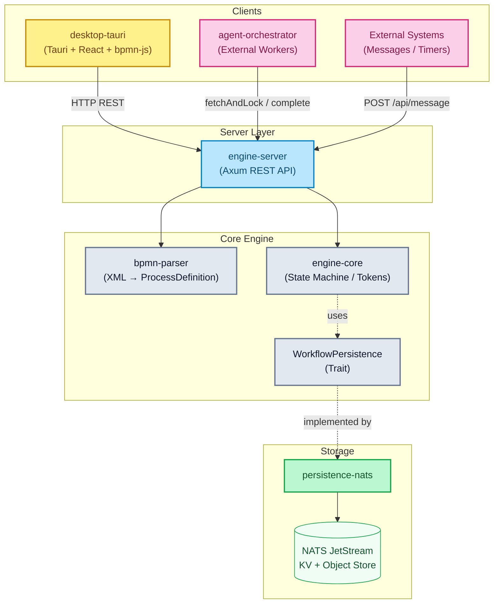

# BPMNinja

[](https://www.rust-lang.org/)
[](.github/workflows/ci.yml)
[](https://github.com/maatini/bpmninja/actions/workflows/mutation-tests.yml)
[](#license)

<div align="center">
  
</div>

**A BPMN 2.0 workflow engine written in Rust** — token-based execution, NATS persistence, REST API and desktop UI.

---

## Table of Contents

- [Overview](#overview)
- [Crates (Modules)](#crates-modules)
- [Workspace Scope](#workspace-scope)
- [Supported BPMN Elements](#supported-bpmn-elements)
- [Architecture](#architecture)
- [Quick Start](#quick-start)
- [REST API](#rest-api)
- [External Task Client (TypeScript)](#external-task-client-typescript)
- [Desktop Application (UI)](#desktop-application-ui)
- [Docker Compose](#docker-compose)
- [Test Metrics](#test-metrics)
- [Roadmap](#roadmap)
- [License](#license)

---

## Overview

bpmninja is a BPMN 2.0 engine with the following core features:

- **Token-based execution** — each path is tracked as an independent token
- **37 BPMN element variants** — start/end events, user/service/script tasks, gateways (XOR, AND, OR, complex, event-based), timers, messages, signals, conditional events, boundary events (timer, message, signal, conditional, error, escalation, compensation), link events, call activities, sub-processes
- **Full ISO 8601 timers** — Duration (`PT30S`), AbsoluteDate (`2026-04-06T14:30:00Z`), Cron (`0 9 * * MON-FRI`), Repeating Interval (`R3/PT10M`)
- **Lock-free concurrency** — multi-threaded scaling via `DashMap` wait-state queues with atomic `remove_if` for race-condition-free task operations
- **NATS JetStream persistence** — KV stores for instances, object store for files, event streaming for history
- **Fault-tolerant retry queue** — two-stage retry (inline + **bounded** background worker) for NATS outages; drops + metrics when the queue is full
- **Fail-closed durability** — `REQUIRE_NATS` defaults to true (also docker-compose) and refuses silent in-memory fallback; `/api/ready` mirrors persistence health
- **Optional deploy-time model checking** — Cargo feature `model-check` (off by default) runs [rust_bpmn_analyzer](https://github.com/timKraeuter/rust_bpmn_analyzer) (MIT, pinned git revision) for deadlocks, livelocks, unsafe parallelism and dead activities. Runtime `MODEL_CHECK` defaults to `off`; `warn` returns findings with the deploy, `enforce` rejects confirmed violations. See [Environment variables](docs/env.md#engine-server)
- **Upload limits** — multipart instance files capped via `MAX_UPLOAD_BYTES` (default 5 MiB → HTTP 413)
- **Automatic timer scheduler** — background task sleeps until the next timer is due (`TIMER_INTERVAL_MS` is the maximum idle wait)
- **Camunda-compatible service tasks** — fetch-and-lock pattern with long polling
- **Rhai script engine** — sandboxed execution listeners (ops / memory budget / timeout)
- **Call Activities** — call another deployed process definition (`calledElement`); variables are propagated in both directions; BPMN error boundaries supported
- **Suspend / resume** — pause and continue instances (timers and tasks blocked)
- **Incident management** — handle failed service tasks with retry/resolve directly from the UI
- **Historical instance archival** — completed instances are automatically archived to a separate store with search by definition, business key, date range, status and pagination
- **Push-based UI updates** — engine fires SSE events (`GET /api/events`) on every state change; Tauri desktop app subscribes via a background task and emits Tauri events to React components, replacing polling
- **Persistent log buffer** — rolling 5000-entry log stream captured by a custom `tracing` layer; queryable via `GET /api/logs` with level and text filters; automatically persisted to NATS JetStream (`ENGINE_LOGS` stream, 50 000 entries) when NATS is available, with a local JSON-Lines file as fallback (`engine_logs.jsonl`, gitignored; set `LOG_FILE=off` to disable)
- **Prometheus metrics** — all key engine metrics exported at `/metrics` via `metrics-exporter-prometheus`
- **Multi-arch Docker images** — CI builds `linux/amd64` + `linux/arm64` images via GitHub Actions with layer cache
- **Desktop UI** — Tauri app with bpmn-js modeler, live instance/definition tracking with push updates, log stream viewer, history page for archived instances, storage mode badge (NATS / In-Memory), and DataViewer with automatic MIME/base64 detection (cross-platform releases via GitHub Actions CI)

---

## Crates (Modules)

| Crate | Purpose |
|-------|---------|
| **`engine-core`** | Core library — state machine, token registry, gateway routing, condition evaluator, script engine |
| **`bpmn-parser`** | Parses BPMN 2.0 XML (`quick-xml` + `serde`) into internal `ProcessDefinition` structs |
| **`persistence-nats`** | NATS JetStream-based `WorkflowPersistence` implementation (KV, Object Store, Streams) |
| **`persistence-memory`** | In-Memory `WorkflowPersistence` implementation for testing and development |
| **`engine-server`** | Axum HTTP REST API with type-safe error handling (`AppError` → HTTP status codes) |
| **`desktop-tauri`** | Tauri desktop app (React + bpmn-js) with modeler, instances dashboard, event history and historical instance search |
| **`agent-orchestrator`** | Sample worker for external service task processing |
| **`bpmn-ninja-external-task-client`** | TypeScript/Node worker client (ESM) — long polling, retry, lock extension, graceful shutdown |

---

## Workspace Scope

The Rust root workspace (`Cargo.toml`) currently includes:

- `engine-core`
- `bpmn-parser`
- `persistence-nats`
- `persistence-memory`
- `engine-server`
- `agent-orchestrator`

Separately managed modules:

- `desktop-tauri/src-tauri` (own Cargo project, built via `desktop-tauri`)
- `fuzz` (separate `cargo-fuzz` workspace)

For full local verification, run the root checks plus module-specific checks from `desktop-tauri` and `fuzz`.

---

## Supported BPMN Elements

### Basic Elements

| BPMN | Element | Description |
|:---:|---|---|
|  | **StartEvent** | Simple starting point — process starts immediately. |
|  | **TimerStartEvent** | Timer-triggered start — supports ISO 8601 Duration (`PT30S`), AbsoluteDate, cron cycle and repeating intervals. |
|  | **MessageStartEvent** | Process is started by an incoming message (via `messageName`). |
| | **SignalStartEvent** | Process is started by a broadcast signal (via `signalRef`). A signal starts one instance per deployed matching definition. |
|  | **EndEvent** | End point — process instance is marked as completed. |
|  | **TerminateEndEvent** | End point — immediately aborts all active tokens. |
|  | **ErrorEndEvent** | Terminates the process with a BPMN error code (`errorCode`). |
| | **EscalationEndEvent** | Ends the current path and throws a BPMN escalation (`escalationCode`). Uncaught escalations are non-fatal. |
| | **CompensationEndEvent** | Runs registered compensation handlers (optional `activityRef`, otherwise LIFO), then completes the token. |
| | **SignalEndEvent** | Broadcasts a BPMN signal (`signalRef`), then completes the token. |
|  | **UserTask** | Creates a pending task that must be completed externally. Assignee comes from `data-assignee`, then `camunda:assignee` (fallback `"unassigned"`). |
|  | **ServiceTask** | External processing via fetch-and-lock pattern (Camunda-compatible). Topic comes from `data-topic`, then `data-handler`, then `camunda:topic`, then the node id. |
|  | **ScriptTask** | Executes inline scripts via the Rhai engine. |
|  | **SendTask** | Sends a message via throw event and continues immediately. |

### Gateways

| BPMN | Element | Description |
|:---:|---|---|
|  | **ExclusiveGateway (XOR)** | Exactly one path is chosen (condition evaluation). Optional default flow. |
|  | **ParallelGateway (AND)** | All paths are followed in parallel (token fork). Join waits for all tokens (JoinBarrier). |
|  | **InclusiveGateway (OR)** | Split: all outgoing paths with a `true` condition (unconditional flows always). Join waits for taken split branches (`expected_count` = split branch count). Unstructured joins without `find_downstream_join` fall back to `incoming_flow_count`. |
|  | **EventBasedGateway** | Execution pauses until exactly one of the target catch events (timer/message/signal) fires. Conditional catches are rejected here. |
| | **ComplexGateway** | Split: all matching conditions, optional default flow. Join waits for all incoming tokens, or fires early when `activationCondition` is true on the merged variables of arrived tokens. |

### Intermediate Events

| BPMN | Element | Description |
|:---:|---|---|
|  | **TimerCatchEvent** | Pauses the process until a timer expires. Supports Duration, AbsoluteDate, cron and repeating intervals. Automatically processed by the timer scheduler. |
|  | **MessageCatchEvent** | Pauses the process until a matching message is correlated via `POST /api/message`. |
| | **SignalCatchEvent** | Pauses the process until a matching signal is broadcast via `POST /api/signal` or thrown inside a process. |
| | **SignalThrowEvent** | Broadcasts a signal to all waiting catches (process-local) and continues immediately. Does not start new instances. |
| | **ConditionalCatchEvent** | Pauses the process until the `conditionExpression` evaluates to `true` against the instance variables. Evaluated after every batch that changes variables. |
|  | **BoundaryTimerEvent** | Timer event attached to a task (interrupting/non-interrupting). Timer is automatically cancelled when the task completes. |
|  | **BoundaryMessageEvent** | Message event attached to a task (interrupting/non-interrupting). Waits asynchronously for external messages. |
| | **BoundarySignalEvent** | Signal event attached to a task (interrupting/non-interrupting). The interrupting variant cancels the activity and its wait states. |
| | **BoundaryConditionalEvent** | Conditional event attached to a task (interrupting/non-interrupting). Fires on a `false → true` transition of its condition; the non-interrupting variant stays registered. |
|  | **BoundaryErrorEvent** | Catches BPMN errors (`errorCode`) of a ServiceTask and routes onto an alternative path. |
| | **BoundaryEscalationEvent** | Catches a BPMN escalation on the attached activity (interrupting or non-interrupting). |
| | **BoundaryCompensationEvent** | Registered when the attached activity completes successfully. Later executed by a compensation throw/end event. |
| | **EscalationThrowEvent** | Throws a BPMN escalation. A matching `BoundaryEscalationEvent` handles it; uncaught escalations continue the token. |
| | **CompensationThrowEvent** | Runs registered compensation handlers (`activityRef` or all in LIFO order) and continues. |
| | **LinkThrowEvent** | Intermediate link throw: jumps to the successor of the matching link catch (`linkEventDefinition name`) in the same scope. The catch node itself is not materialised. |

### Activities & Sub-Processes

| BPMN | Element | Description |
|:---:|---|---|
|  | **CallActivity** | Calls another process definition (`calledElement`). Variables are propagated. |
|  | **EmbeddedSubProcess** | Embedded sub-process (flattened into the graph). |
|  | **SubProcessEndEvent** | Internal end event of an embedded sub-process (generated during flattening). |

### Additional Concepts

| Feature | Description |
|---------|-------------|
| **Conditional Flows** | Edges with conditions (`amount > 100`, `status == 'approved'`, `${amount > 100 && approved}`). Supports `&&`/`and`, `\|\|`/`or`, `!`/`not`, `==`, `!=`, `>`, `<`, `>=`, `<=`, arithmetic `+ - * / %`, parentheses, numbers, single- and double-quoted strings with escapes, `true`/`false`/`null`, and dotted/array paths (`order.amount`, `items[0].id`). |
| **Execution Listeners** | Start/end scripts on nodes (Rhai). Can read and mutate variables. |
| **Scope Event Listeners** | Timer/message/error event sub-processes at scope level (interrupting/non-interrupting). |
| **File Variables** | Upload/download of files as process variables via NATS Object Store. |
| **Message Correlation** | Matching via `messageName` + optional `businessKey`. |
| **Signal Correlation** | Broadcast via `POST /api/signal`; wakes every waiting `SignalCatchEvent` and starts instances with a `SignalStartEvent`. Broadcast is process-local (single engine node). |
| **BPMN Error Handling** | ServiceTasks report errors via `bpmnError`. Routing to the matching `BoundaryErrorEvent`. |
| **Detailed History** | Gap-free event log with diffs, snapshots and actors (`User`, `Engine`, `Timer`, `ServiceWorker`). |
| **Instance Archival** | Completed instances are archived to a dedicated store. Searchable by definition key, business key, date range, status with pagination. |
| **Persistent Wait States** | Timers, messages, signals, conditional catches and user/service tasks survive server restarts via NATS KV. |
| **Structured JSON Logging** | Configurable via `tracing-subscriber` with the JSON feature and `RUST_LOG` filter. |

**Conditional flow details.** A complete `${…}` or `#{…}` wrapper is stripped before evaluation; a wrapper in the middle of an expression or a missing closing brace is a syntax error. `&&`/`||` short-circuit, missing variables compare as `false`, and a missing value is not the same as `null`. Invalid `conditionExpression` and `complexGateway` `activationCondition` values are rejected at deploy time with `InvalidDefinition` (source/target node plus character position), so a broken model no longer falls through to the default flow silently.

### Deviations from the BPMN 2.0 Standard

For performance and architectural reasons (keep it simple), bpmninja deviates from the strict BPMN 2.0 standard in a few points:

- **Service Tasks (External Task Pattern):** Instead of synchronously executing code inside the engine, `Service Tasks` pause execution. They place the task asynchronously into a fetch-and-lock queue (similar to Camunda), from where external workers fetch tasks (`topic`-based) and report completion via the API. A topic can instead be claimed by an in-process `TaskHandler` registered on `WorkflowEngine`; that topic is then hidden from external workers and executed by the engine's dispatcher with the same lock, retry and BPMN-error semantics.
- **Embedded Sub-Processes (Flattening):** Embedded sub-processes are resolved directly at parse time and inlined deep into the main graph (**flattening**). At runtime there are no complex nested instance structures, only direct node sequences. Returns from the sub-process are handled via simulated `SubProcessEndEvent`s in the same variable scope.
- **Script Tasks:** Script evaluation is not done via JavaScript or Groovy, but natively in Rust via the **Rhai engine**.
- **Multi-Instance (Service Tasks only):** Parallel and sequential `multiInstanceLoopCharacteristics` are supported on `serviceTask` via `collection` + `elementVariable` or `loopCardinality`. In both modes `loopCounter` starts at 1 and the instance advances once after all items complete. Parallel MI creates all pending tasks up front; sequential MI (`isSequential="true"`) keeps exactly one task open and creates the next one after each completion, preserving collection order and the `elementVariable` value per iteration. Multi-instance on any other task type is rejected at deploy time with `InvalidDefinition`.
- **Inclusive Gateway join:** Split follows BPMN OR (every outgoing flow whose condition is true). Join waits for taken paths: `expected_count` is the matching split's taken branch count (via `find_downstream_join`). Unstructured joins without a matching split fall back to AND-style `incoming_flow_count`.
- **Camunda assignee/topic attributes:** User tasks read `data-assignee` first, then `camunda:assignee` (quick-xml strips the prefix to `@assignee`; fallback `"unassigned"`). Service tasks read `data-topic`, then `data-handler`, then `camunda:topic` (`@topic`), then the node id.
- **Task type mapping:** `receiveTask`, `manualTask`, `businessRuleTask`, and generic `task` are parsed as `ServiceTask` (topic = `name` or node id). An empty `scriptTask` body becomes a `ServiceTask`. An intermediate catch event without timer or message becomes a `ServiceTask` with topic `event_passthrough`. There is no DMN engine for business-rule tasks.
- **One process per file:** Only the first `<process isExecutable="true">` is deployed; if none is marked executable, the first `<process>` is used. Further processes in the same file are ignored.

### Currently Unsupported BPMN Elements

The engine focuses on a practical and performant core feature set. The following BPMN elements are currently **not** supported and will either cause parser errors on deployment or be silently ignored:

- **Event scope:** Signal events are supported for start, intermediate catch/throw, end and boundary (interrupting/non-interrupting); the broadcast is process-local, so multiple engine nodes do not fan out. Conditional events are supported for intermediate catch and boundary only. A **conditional start event** is rejected at deploy time with `InvalidDefinition` because the engine has no global variable scope to trigger it. An event-based gateway cannot target a conditional catch. Link events are supported: a link throw jumps to the target of its link catch within the same scope; cross-scope links are rejected.
- **Cancel events & transactions:** `cancelEventDefinition` on end and boundary events is recognised but rejected at deploy time with `InvalidDefinition` — cancel events require a BPMN transaction, and transaction sub-processes are not supported. A `<transaction>` element is rejected with the same reasoning.
- **Extended sub-processes:** `Ad-Hoc Sub-Process`. (`Transaction Sub-Process` is rejected explicitly; see cancel events above.)
- **Data Objects / Data Stores:** Visual data objects and associations (`Data Input/Output Association`) are ignored. Data exchange is done exclusively via the JSON variable state (`HashMap<String, serde_json::Value>`).

---

## Architecture

> Detailed documentation with 8 Mermaid diagrams: **[docs/architecture.md](docs/architecture.md)**



---

## Quick Start

### Prerequisites

**Option A: Devbox** (recommended)
```bash
# Automatically installs Rust, Node.js and NATS
devbox shell
```

**Option B: Manual**
- Rust (via `rustup`)
- Node.js ≥ 18
- Docker & Docker Compose

### Build, Test & Lint

| Action | Devbox | Shell |
|--------|--------|-------|
| **Build** | `devbox run build` | `cargo build --workspace` |
| **Test** | `devbox run test` | `cargo test --workspace` |
| **Coverage** | `devbox run coverage` | `cargo llvm-cov --workspace --all-targets --summary-only` |
| **Lint** | `devbox run lint` | `cargo clippy --workspace -- -D warnings` |
| **Format** | `devbox run fmt` | `cargo fmt --all --check` |

### Nx (Task-Orchestrierung)

Nx 24.0.1 orchestriert lokal die Projekte `rust`, `desktop`, `client` und `api-spec`; Cargo bleibt die Build-Engine. In der CI plant Nx nur: `nrwl/nx-set-shas` plus `nx show projects --affected` im Job `plan` ermitteln die betroffenen Projekte, die Build-Jobs rufen anschließend cargo und npm direkt auf. Nx-Cache und Targets sind lokal, in der CI gibt es keinen Nx-Cache. Die Rust-Inputs umfassen zusätzlich `deny.toml`, `.github/workflows/**`, `package.json`, `package-lock.json` und `nx.json`, damit Infrastrukturänderungen die Rust-Jobs auslösen. Das `test`-Target von `client` nutzt `rustSources` als Input, weil sein Integrationstest das `engine-server`-Binary startet. Das Rust-Projekt `rust` hat `cache: false`, seine Targets werden also nicht gecacht. Aufruf über `npm exec -- nx …` (alternativ `./node_modules/.bin/nx`); der Aufruf über `npx` scheitert in der Devbox mit `Missing script: nx`. Verfügbare Projekte zeigt `npm exec -- nx show projects`.

```bash
npm exec -- nx run-many -t lint test build   # alle Projekte, parallel
npm exec -- nx affected -t lint test build   # nur betroffene Projekte (Basis: main)
npm exec -- nx run rust:test                 # einzelnes Target (cargo nextest run --workspace)
npm exec -- nx graph                         # Projekt-/Task-Graph im Browser
```

### Starting the Engine Server

```bash
# 1. Start NATS
docker compose up -d nats

# 2. Start the engine server
cargo run -p engine-server
```

The server runs at `http://localhost:8081`.

#### Environment Variables

| Variable | Default | Description |
|----------|---------|-------------|
| `NATS_URL` | `nats://localhost:4222` | NATS server URL |
| `REQUIRE_NATS` | `true` | Fail-closed: refuse to start without NATS (no silent in-memory fallback). Set `false` for ephemeral local runs; `/api/ready` requires persistence when enabled |
| `BIND_ADDR` | `0.0.0.0` | Listen address (alias `BIND_ADDRESS`) |
| `PORT` | `8081` | HTTP server port |
| `RUST_LOG` | `info` | Log level filter (e.g. `debug`, `warn`, `engine_server=trace`) |
| `MODEL_CHECK` | `off` | Deploy-time check: `off`, `warn` (findings in the response and the log), `enforce` (reject confirmed violations). Requires `--features model-check` |
| `MODEL_CHECK_TIMEOUT_MS` | `2000` | How long a deploy waits for that check |

Vollständige Liste (Auth, Upload-/XML-Limits, Logging, Retry-Queue, Rhai-Sandbox, NATS-Retention, Model-Checking, Client-Variablen): **[docs/env.md](docs/env.md)**.

Model checking is not in the default binary or the published image. Build it explicitly:

```bash
cargo run -p engine-server --features model-check
```

`warn` still deploys when the analyzer finds a problem, times out, or panics; the response field `model_check` explains which. `enforce` returns HTTP 400 with `error` and `model_check` for a confirmed violation. A timeout, a panic, or a second deploy while one analysis is running does not fail the deploy in either mode (the single in-flight analysis runs on a blocking thread and is capped by `MODEL_CHECK_TIMEOUT_MS`). Setting `enforce` on a binary built without the feature rejects every deploy, so the switch cannot fail open.


---

## REST API

> Complete OpenAPI 3.0 specification: **[docs/openapi.yaml](docs/openapi.yaml)** | 🌐 **[API Portal (Redoc)](https://maatini.github.io/bpmninja/)** *(requires an active GitHub Pages deploy via /docs)*

### Definitions

| Method | Path | Description |
|--------|------|-------------|
| `POST` | `/api/deploy` | Deploy a BPMN definition (max 10 MB). With `MODEL_CHECK=warn` or `enforce` the response includes `model_check` |
| `GET` | `/api/definitions` | List all definitions |
| `GET` | `/api/definitions/:id/xml` | Retrieve the BPMN XML of a definition |
| `DELETE` | `/api/definitions/:id` | Delete a definition (`?cascade=true` to also delete instances) |
| `DELETE` | `/api/definitions/bpmn/:bpmn_id` | Delete all versions of a BPMN ID |

### Instances

| Method | Path | Description |
|--------|------|-------------|
| `POST` | `/api/start` | Start an instance (by `definition_key`) |
| `POST` | `/api/start/latest` | Start an instance of the latest version (by `bpmn_process_id`) |
| `POST` | `/api/start/timer` | Start a timer start event instance (repeating intervals) |
| `GET` | `/api/instances` | List all instances |
| `GET` | `/api/instances/:id` | Retrieve instance details |
| `DELETE` | `/api/instances/:id` | Delete an instance |
| `POST` | `/api/instances/:id/suspend` | Suspend an instance (timers/tasks paused) |
| `POST` | `/api/instances/:id/resume` | Resume a suspended instance |
| `PUT` | `/api/instances/:id/variables` | Update variables |
| `POST` | `/api/instances/:id/move-token` | Move a token to a different node (modify process instance) |
| `POST` | `/api/instances/:id/migrate` | Migrate an instance to a different definition version (with optional node mapping) |

### User Tasks

| Method | Path | Description |
|--------|------|-------------|
| `GET` | `/api/tasks` | List all pending user tasks |
| `POST` | `/api/complete/:id` | Complete a user task |

### Service Tasks (Camunda-compatible)

| Method | Path | Description |
|--------|------|-------------|
| `GET` | `/api/service-tasks` | List all service tasks |
| `POST` | `/api/service-task/fetchAndLock` | Fetch and lock tasks (long polling) |
| `POST` | `/api/service-task/:id/complete` | Complete a task successfully |
| `POST` | `/api/service-task/:id/failure` | Mark a task as failed |
| `POST` | `/api/service-task/:id/retry` | Retry an incident (reset retries) |
| `POST` | `/api/service-task/:id/resolve` | Resolve an incident manually (complete the task without a worker) |
| `POST` | `/api/service-task/:id/extendLock` | Extend the lock |
| `POST` | `/api/service-task/:id/bpmnError` | Report a BPMN error |

### Files

| Method | Path | Description |
|--------|------|-------------|
| `POST` | `/api/instances/:id/files/:var` | Upload a file (multipart) |
| `GET` | `/api/instances/:id/files/:var` | Download a file |
| `DELETE` | `/api/instances/:id/files/:var` | Delete a file variable |

### Events & Messages

| Method | Path | Description |
|--------|------|-------------|
| `POST` | `/api/message` | Correlate a message |
| `GET` | `/api/messages` | List all pending message subscriptions |
| `POST` | `/api/signal` | Broadcast a signal (`{ signalName, variables? }`) → affected instance IDs |
| `GET` | `/api/signals` | List all pending signal catches |
| `GET` | `/api/timers` | List all active timers |
| `POST` | `/api/timers/process` | Manually process expired timers |

### History & Archival

| Method | Path | Description |
|--------|------|-------------|
| `GET` | `/api/instances/:id/history` | Event history of an instance (with filter query params) |
| `GET` | `/api/instances/:id/history/:eid` | A single history event |
| `GET` | `/api/history/instances` | List archived (completed) instances with filters (`definition_key`, `business_key`, `from`, `to`, `state`, `limit`, `offset`) |
| `GET` | `/api/history/instances/:id` | Load a single archived or active instance by ID |

### Monitoring & Health

| Method | Path | Description |
|--------|------|-------------|
| `GET` | `/api/health` | Liveness check → always `200 OK` while the process is up |
| `GET` | `/api/ready` | Readiness: `503` if required persistence is missing (`REQUIRE_NATS`) or NATS is disconnected |
| `GET` | `/api/info` | Backend info (type, NATS URL, status) |
| `GET` | `/api/monitoring` | Engine statistics (instances, tasks, storage, errors) |
| `GET` | `/api/monitoring/buckets/:bucket/entries` | List KV bucket entries |
| `GET` | `/api/monitoring/buckets/:bucket/entries/:key` | Load a single KV entry |
| `GET` | `/metrics` | Prometheus metrics (counters, gauges for instances/tasks/errors) |

### Observability

| Method | Path | Description |
|--------|------|-------------|
| `GET` | `/api/logs` | Query the in-memory rolling log buffer (`?level=info&search=…&limit=500`) |
| `GET` | `/api/events` | Server-Sent Events stream — fires `instance_changed`, `task_changed`, `definition_changed` on every state mutation |

### Error Handling

All errors follow a uniform JSON format:

```json
{ "error": "Human-readable error message" }
```

| HTTP code | Meaning |
|-----------|---------|
| `400` | Bad request (bad XML, invalid UUID, missing fields) |
| `404` | Resource not found (definition, instance, task, node) |
| `409` | Conflict (task not pending, already locked, already completed) |
| `500` | Internal server error |

---

## External Task Client (TypeScript)

The package **[`@bpmninja/external-task-client`](bpmn-ninja-external-task-client/README.md)** is a production-ready worker client for the BPMNinja service task API. It is modelled on the [Camunda External Task Client](https://github.com/camunda/camunda-external-task-client-js), but talks directly to the BPMNinja REST endpoints under `/api/service-task/*`.

### Features

- **Long polling** — efficient fetch-and-lock with configurable `asyncResponseTimeout`
- **Multi-topic subscriptions** — multiple topics in parallel with individual handlers
- **Global retry with exponential backoff** — automatic retry on handler errors (`1s → 2s → 4s → …`, capped at 30s)
- **Automatic lock extension** — prevents lock expiration for long-running tasks
- **Incident creation** — after retries are exhausted, an incident is created on the process (`failure` with `retries: 0`)
- **BPMN error throwing** — triggers boundary error events directly from the worker
- **Graceful shutdown** — waits for in-flight handlers, cancels fetches via `AbortController`
- **Strict TypeScript** — `strict: true`, ESM, native `fetch()` (Node ≥ 18), no HTTP dependencies
- **Pino logging** — structured logging, disable via `logger: false`

### Quick Start

```typescript
import { ExternalTaskClient } from "@bpmninja/external-task-client";

const client = new ExternalTaskClient({
  baseUrl: "http://localhost:8081",
  workerId: "demo-worker-01",
  maxRetries: 3,
  autoExtendLock: true,
});

client.subscribe("send-email", async (task, service) => {
  const { recipient, subject } = task.variables_snapshot as {
    recipient: string;
    subject: string;
  };

  await sendEmail(recipient, subject);

  await service.complete({
    emailSent: true,
    sentAt: new Date().toISOString(),
  });
});

// Throw a BPMN error from the worker (Boundary Error Event)
client.subscribe("validate-order", async (task, service) => {
  const { amount } = task.variables_snapshot as { amount: number };
  if (amount > 10_000) {
    await service.bpmnError("ORDER_LIMIT_EXCEEDED");
    return;
  }
  await service.complete({ orderValid: true });
});

client.start();

// Graceful shutdown
process.on("SIGINT", async () => {
  await client.stop();
  process.exit(0);
});
```

### TaskService (per handler)

| Method | Description |
|--------|-------------|
| `complete(variables?)` | Complete the task successfully, optionally with output variables |
| `failure(msg, details?, retries?)` | Report a failure; `retries: 0` creates an incident |
| `extendLock(ms)` | Extend the lock (ms, internally converted to seconds) |
| `bpmnError(errorCode)` | Trigger a BPMN error event on the attached boundary |

### Development & Tests

```bash
cd bpmn-ninja-external-task-client
npm install
npm run lint     # tsc --noEmit
npm run test     # vitest run  (85 tests)
npm run example  # tsx example/simple-worker.ts
```

The full example (`send-email`, `validate-order`, `flaky-task`, shutdown) is in [`bpmn-ninja-external-task-client/example/simple-worker.ts`](bpmn-ninja-external-task-client/example/simple-worker.ts). A complete API reference is available in the [package README](bpmn-ninja-external-task-client/README.md).

---

## Desktop Application (UI)

The Tauri app connects to the `engine-server` via HTTP and receives real-time push updates via Server-Sent Events — no polling required for core state views.

**Key UI pages:**
- **Modeler** — bpmn-js canvas with properties panel (execution listeners, default flow conditions, called element configuration)
- **Instances** — live list of running instances with token highlighting, variable editor, history timeline and token move
- **Process Definitions** — BPMN diagram with live token overlay, incident list and service task monitoring
- **Pending Tasks** — user tasks and service task incidents with completion dialogs
- **Overview** — pending timers, messages and service jobs
- **History** — searchable archive of completed instances (by definition, business key, date range, status)
- **Monitoring** — NATS storage info, KV bucket browser, engine statistics, live log stream (filterable by level and text) and storage mode badge (NATS / In-Memory) in both the sidebar and the monitoring page header

> **Prerequisite**: a running backend (NATS + engine server). By default, the app expects the backend at `http://localhost:8081` (configurable via `ENGINE_API_URL`).

### 1. Run the backend prerequisites

Save the following `docker-compose.yml` locally on your machine and start it via `docker compose up -d`. The ready-to-use backend image is pulled automatically from the GitHub Container Registry:

```yaml
services:
  nats:
    image: nats:alpine
    command: ["--js", "--sd", "/data"]
    ports:
      - "4222:4222"
      - "8222:8222"
    volumes:
      - nats-data:/data

  engine-server:
    image: ghcr.io/maatini/bpmninja/engine-server:latest
    ports:
      - "8081:8081"
    environment:
      - PORT=8081
      - NATS_URL=nats://nats:4222
      - REQUIRE_NATS=true
    depends_on:
      - nats

volumes:
  nats-data:
```

### 2. Install the desktop app binary release

The ready-to-use apps are available on the [GitHub Releases page](https://github.com/maatini/bpmninja/releases).

*   **macOS (.dmg):** Open the file and drag the icon into your `Applications` folder. _Note:_ since open-source apps are usually not signed, macOS may report that the app is "damaged" and should be moved to the Trash when you try to open it. This is a known Gatekeeper protection behaviour. Run `xattr -cr /Applications/bpmninja-desktop.app` in the terminal to remove the quarantine flag. After that, the app can be opened normally.
*   **Windows (.exe / .msi):** Run the installer by double-clicking it. If a Microsoft SmartScreen warning appears, click "More info" and then "Run anyway".
*   **Linux (.AppImage / .deb):** Install the `.deb` package via `sudo dpkg -i package.deb`. If you use the `.AppImage`, you may need to make it executable first with `chmod +x app.AppImage`.

### 3. Running from source (for developers)

If you want to run the UI directly from the source repository:

```bash
# Devbox
devbox run ui:dev

# Or manually
cd desktop-tauri && npm install && npm run tauri dev
```

---

## Docker Compose

Starts NATS + engine server as containers:

```bash
# Devbox
devbox run engine:docker

# Or manually
docker compose up --build
```

Services reachable at `localhost:8081` (API) and `localhost:4222` (NATS).

The compose file includes a **cobra-nats** service (`natsio/nats-box`) which provides the NATS CLI inside the Docker network for ad-hoc inspection of streams, KV buckets and subjects without a local installation.

---

## Test Metrics

> Snapshot from 2026-10-24. The authoritative source is CI (`.github/workflows/ci.yml` + `.github/workflows/fuzzing.yml`).

<!-- QUALITY_METRICS:START -->
- Letztes Update (UTC): `2026-10-24T05:27:07.168644+00:00`
- Mutation Score: **68.9%** (caught: 406, missed: 182, timeout: 1)
- Fuzzing: **9/9 targets** (ok)
<!-- QUALITY_METRICS:END -->

### Workspace Overview

| Package | Unit | E2E | Total |
|---------|------|-----|-------|
| **engine-core** | 319 | 5 | 324 |
| **bpmn-parser** | 91 | — | 91 |
| **persistence-nats** | 20 | — | 20 |
| **persistence-memory** | 2 | — | 2 |
| **engine-server** | 50 | 100 | 150 |
| **desktop-tauri** | — | 52 | 52 |
| **bpmn-ninja-external-task-client** | 85 | — | 85 |
| **Total** | **567** | **157** | **724** |

> Authoritative (2026-10-29 for engine-server test counts; 2026-10-24 for the other packages and for coverage below): `cargo test --workspace -- --list` (Rust, devbox toolchain 1.99.0), `node ./node_modules/@playwright/test/cli.js test --list` (desktop-tauri), `node ./node_modules/vitest/vitest.mjs list` (external task client). Counts are listed test cases. The three `e2e_model_check` cases and the ten `model_check` unit tests are the default feature set; `--features model-check` adds the analyzer cases.

### Line Coverage

Measured with `cargo llvm-cov --workspace --all-targets` (LLVM source-based coverage, test code excluded).
CI job **Rust line coverage** runs the same measurement, fails below **75 %** lines and uploads `lcov.info`.

| Crate | Lines | Line coverage |
|-------|-------|---------------|
| **engine-core** | 9,868 | 86.7 % |
| **bpmn-parser** | 1,336 | 74.8 % |
| **engine-server** | 2,728 | 78.6 % |
| **persistence-nats** | 805 | 54.0 % |
| **persistence-memory** | 101 | 100.0 % |
| **agent-orchestrator** | 115 | 0.0 % (demo binary, no tests) |
| **Total** | **14,953** | **81.8 %** |

Overall: **82.2 %** regions, **75.9 %** functions, **81.8 %** lines.

### engine-core Breakdown (324 tests)

| Module | Tests | Coverage |
|--------|-------|----------|
| `engine::tests::instance_admin` | 33 | Audit log, restore from persistence, definition versioning/cascade delete, large file variables, `Send`/`Sync` |
| `engine::tests::timers_messages` | 25 | Timers, boundary timer/message, message start/catch, event-based gateway races, failed-timer incidents |
| `engine::tests::stress_tests` | 24 | Throughput, gateway correctness, crash recovery, concurrency, race conditions, memory, infinite loops |
| `engine::tests::call_errors` | 18 | Call activity lifecycle, variable/error propagation, error boundary events, compensation |
| `engine::tests::gateways` | 20 | XOR/OR/AND forks and joins, defaults, downstream join detection, compound conditions |
| `engine::tests::start_tasks` | 12 | User/service tasks, conditional routing, lock/retry, BPMN error handling |
| `engine::tests::topic_index` | 7 | Per-topic lock durations, orphaned entries, restore, incident filtering |
| `engine::retry_queue::tests` | 7 | Display, shutdown/drain budget, skip missing entities, full-queue drop, persistence incidents |
| `engine::tests::migration` | 6 | Instance migration: same node ids, node mapping, rejected for completed/suspended instances |
| `engine::tests::multi_instance` | 10 | Parallel and sequential collection/loop-cardinality multi-instance, snapshots, error cases |
| `engine::tests::scripting` | 6 | Rhai listeners, memory budget, safe failure handling, start/end distinction |
| `engine::tests::service_incidents` | 4 | Incidents on failed service tasks, `fetch_and_lock` skips incidents, resolve |
| `engine::tests::sub_process` | 4 | Embedded sub-process start-event pass-through, nested sub-process, default-flow completion |
| `engine::tests::signals` | 9 | Signal broadcast to multiple waiters, signal start, throw/end, boundary interrupting/non-interrupting, event-based gateway, restore |
| `engine::tests::conditional_events` | 10 | Conditional catch/boundary on variable changes, true-on-entry, direct variable updates, no busy loop, restore |
| `engine::tests::link_events` | 2 | Link throw jumps to catch target, scope-local resolution |
| `engine::boundary::tests` | 4 | No-events, timer/message/signal/conditional boundary setup |
| `engine::tests::call_activity_parallel` | 3 | Parallel call activities, parent completion, missing target |
| `engine::tests::inclusive_join` | 3 | Inclusive join with partial branches, nested joins |
| `engine::tests::instance_pagination` | 3 | Offset/limit paging, sort by `started_at` desc, unpaged listing |
| `engine::tests::timer_due_index` | 3 | Due index on delete/restore, future timers not due |
| `engine::tests::recurring_and_event_timer` | 2 | `R3` repeating interval, two event timers with equal duration |
| `engine::tests::xor_merge` | 2 | Exclusive merge with unconditional/default flows |
| `engine::tests::boundary_restore` | 1 | Boundary timer persists and restores |
| `history::tests` | 24 | Diff calculation, human-readable text, truncation, snapshots, UTF-8 safety |
| `domain::tests` | 24 | ProcessDefinition builder, gateway validation, signal/conditional element rules, token serialization, timer definitions |
| `domain::timer::tests` | 15 | Remaining time per timer type, recurring detection, infinite limits |
| `runtime::instance::tests` | 14 | Audit log limits, file variables, file references, incident caps |
| `condition::tests` | 22 | Condition parser/evaluator: precedence, short-circuit, wrappers, escapes, paths, validity |
| `adapter::in_memory::tests` | 2 | Storage info, history query filters |
| Integration tests | 5 | BPMN compliance (3), complex gateways (2) |

### bpmn-parser Tests (91 tests)

| Area | Tests | Coverage |
|------|-------|----------|
| Basic parsing | 10 | Simple BPMN, conditional flows, condition validation (flow and join condition), interleaved bpmn-js output, execution listeners, executable-process selection, Camunda attribute precedence |
| Gateways | 5 | Parallel, exclusive with default, inclusive, event-based, complex |
| Events | 24 | MessageStart, MessageCatch, ErrorEnd, TimerCatch, IntermediateMessageThrow; signal start/catch/throw/end plus missing/unknown `signalRef` rejects; link throw→catch and link-scope rejects; conditional intermediate catch and conditional rejects (missing condition, invalid condition, conditional start, event-based gateway) |
| Boundary events | 4 | BoundaryTimer, BoundaryError, BoundarySignal, BoundaryConditional |
| ISO 8601 timers | 8 | TimeDate, CronCycle, RepeatingInterval, RepeatingInterval-Compact, formal expression, timer start, duration/definition rejects |
| Task types | 9 | ScriptTask, SendTask (incl. `messageRef`), ReceiveTask, BusinessRuleTask, manual task, rejects for empty/generic tasks and business rule without topic |
| Sub-processes | 12 | EventSubProcess, RegularSubProcess, start-event pass-through/implicit split, rejects for missing/multiple start events, flattening keeps send/inclusive/signal events and catch, sub-process default-flow resolution and unknown-default rejects, conditional catch in sub-process |
| Advanced | 8 | TerminateEndEvent, CompensationEvents, EscalationEvents, catch without trigger rejected; cancel end/boundary and `<transaction>` rejected; BPMN without cancel events stays valid |
| Multi-Instance | 9 | Parallel and sequential collection/loop cardinality, rejects for sequential on user tasks, missing/both sources, invalid cardinality |
| Call Activity | 1 | `calledElement` attribute parsing and mapping to `CallActivity` element |
| Namespace handling | 1 | Camunda namespace prefixes on execution listeners (`camunda:executionListener`) |

### engine-server E2E Tests (100 tests, 20 files)

| Test file | Tests | Coverage |
|-----------|-------|----------|
| `e2e_auth_cors.rs` | 19 | Admin/worker API keys, fail-closed on non-loopback bind, escape hatch, CORS allowlist and preflight, auth metrics |
| `e2e_call_activity.rs` | 5 | Call activity spawn, variable propagation, error boundaries, parent/child lifecycle |
| `e2e_deploy.rs` | 5 | Deploy, start, invalid XML → 400, XML retrieval and 404 |
| `e2e_deploy_persist.rs` | 2 | Deploy with/without persistence, save failure → 5xx |
| `e2e_file_variables.rs` | 3 | File upload, task completion with files, multi-file + delete |
| `e2e_files.rs` | 2 | Upload/download/delete lifecycle; oversized upload → 413 |
| `e2e_gateways.rs` | 1 | Parallel gateway over HTTP |
| `e2e_history.rs` | 5 | History generation, querying, business key filter, actor-type filter, pagination |
| `e2e_instances_page.rs` | 2 | `X-Total-Count` header, full-array response without query parameters |
| `e2e_lifecycle.rs` | 6 | Delete instance, delete definition (409 without cascade), unknown instances, process timers, correlate messages |
| `e2e_migration.rs` | 5 | Instance migration (same node ids, node mapping, unknown target, orphaned token → 422) |
| `e2e_model_check.rs` | 3 | `MODEL_CHECK=off` omits the report; without feature `model-check`, warn still deploys (`unavailable`) and enforce returns 400. Feature build: sound model, deadlock finding, structured rejection |
| `e2e_monitoring.rs` | 7 | Health, ready (dev / REQUIRE_NATS), info, credential redaction, monitoring stats |
| `e2e_signals.rs` | 3 | Signal broadcast to waiters, signal start, `GET /api/signals` |
| `e2e_service_tasks.rs` | 13 | List, FetchAndLock (limits and lock-duration validation), ExtendLock, Complete, failure/retries, BPMN error, conflicts, incidents |
| `e2e_start_errors.rs` | 8 | Invalid UUID, unknown definition/BPMN ID, timer-start rejection, malformed JSON, 415/413/422 error objects |
| `e2e_stress.rs` | 2 | Concurrent deployments, concurrent starts (multi-thread) |
| `e2e_suspend_resume.rs` | 5 | Suspend/resume lifecycle, token move (204/404) |
| `e2e_variables.rs` | 1 | Variable updates mid-execution |
| `e2e_versioning.rs` | 3 | Version increment, start-latest, instance isolation |

### desktop-tauri E2E Tests (52 tests, 1 file)

| Test file | Tests | Coverage |
|-----------|-------|----------|
| `app.spec.ts` | 52 | Modeler expressions/conditions, gateway configurations, instance lifecycle (suspend/resume), migration dialog, base64 payload monitoring |

### bpmn-ninja-external-task-client Tests (85 tests, 4 files)

| Test file | Tests | Coverage |
|-----------|-------|----------|
| `retry.test.ts` | 13 | `sleep`, `calculateBackoff`, `withRetry` (exponential backoff, retry exhaustion) |
| `TaskService.test.ts` | 30 | `complete`, `failure`, `extendLock`, `bpmnError` (HTTP contract, timeout/retry, error paths) |
| `ExternalTaskClient.test.ts` | 39 | Constructor, lifecycle, poll loop, subscriptions, handler dispatch, retry, lock extension, graceful shutdown |
| `integration.test.ts` | 3 | Real `engine-server` (via `BPMNINJA_SERVER_BIN`): deploy, fetch/lock, complete, incidents |

The unit tests use `vi.useFakeTimers()` and `vi.stubGlobal('fetch', …)` — no real HTTP calls, no real timers. The integration test is skipped unless `BPMNINJA_SERVER_BIN` points to a built server binary.

### Code Statistics

| Area | Files | LoC |
|------|-------|-----|
| engine-core (lib) | 49 | ~11,500 |
| engine-core (tests) | 3 | ~6,800 |
| bpmn-parser | 4 | ~2,500 |
| persistence-nats | 5 | 1,282 |
| persistence-memory | 2 | ~450 |
| engine-server (lib) | 19 | ~2,400 |
| engine-server (E2E tests) | 20 | ~4,600 |
| desktop-tauri (TypeScript + CSS) | ~55 | ~7,800 |
| desktop-tauri (Rust backend) | 11 | ~900 |
| external-task-client (lib) | 11 | 1,997 |
| external-task-client (tests) | 6 | 1,285 |
| fuzz targets | 9 | 704 |
| **Rust workspace** | **~112** | **~27,950** |
| **Project total** | **~177** | **~38,750** |

### Mutation Score
CI workflow **Core Mutation Tests** runs `cargo-mutants` on `engine-core` and publishes metrics via `docs/quality-metrics.json` / the Mutation Score badge. The metrics parser reads `outcomes.json` (`summary: CaughtMutant|MissedMutant|…`), nested summary counters, and `caught.txt`/`missed.txt` fallbacks. Empty mutation artifacts no longer overwrite a previous successful score with 0.0%. A historical full run (2026-04-13) scored **72.4%**; the auto-updated QUALITY_METRICS block above reflects the latest successful CI merge. Artifacts are retained 30 days.

The metrics are published weekly (Mondays) on the `metrics` branch — the badge at the top of this README points there. `continue-on-error` stays in place for the `cargo-mutants` run itself; the separate `Mutation-Trend prüfen` step compares the score against the previous value on the `metrics` branch and fails below the **65 %** threshold or on a trend regression.

### Continuous Fuzzing
To safeguard security- and stability-critical parser and execution components, a parallel **fuzzing workflow** based on `cargo-fuzz` (libFuzzer) runs daily in the CI/CD pipeline (and on relevant pull requests).

Currently 9 dedicated fuzz targets are implemented:
* **`fuzz_bpmn_parser`**: Feeds the `quick-xml` parser with arbitrary UTF-8 strings.
* **`fuzz_condition`**: Tests the `evaluate_condition` parser with wild expression/variable combinations.
* **`fuzz_rhai_script`**: Checks memory limits and sandboxing when executing manipulated scripts.
* **`fuzz_iso8601_duration`**: Stresses the ISO 8601 parsing logic for timers.
* **`fuzz_token_deserialize`**: Deserializes arbitrary JSON as Token, ProcessInstance, HistoryEntry and FileReference.
* **`fuzz_cron_expression`**: Parses arbitrary strings as cron expressions via `croner`.
* **`fuzz_deploy_roundtrip`**: End-to-end pipeline: XML → Parse → Deploy → Start Instance.
* **`fuzz_history_diff`**: Fuzzes `calculate_diff` and `calculate_diff_from_snapshot` with `arbitrary`-generated structured input — boundary-length strings (incl. multi-byte UTF-8), large arrays, deeply nested JSON, file-reference-shaped objects, and all `InstanceState` variants.
* **`fuzz_server_payloads`**: Deserializes arbitrary bytes against all 18 REST API DTOs (`FetchAndLockRequest`, `DeployRequest`, `StartRequest`, `CorrelateMessageRequest`, etc.) to ensure no panics on malformed input.

Sanitizers (AddressSanitizer) are enabled by default and will cause a structured abort and upload of crash artifacts on *memory leaks*, *panics* or *undefined behaviour*.

---

## Roadmap

| Feature | Status |
|---------|--------|
| Embedded sub-processes (BPMN scopes) | ✅ Implemented |
| Event-based gateway | ✅ Implemented |
| Structured JSON logging (`tracing-subscriber` + JSON) | ✅ Implemented |
| Camunda 7-compatible flow conditions (expression/script) | ✅ Implemented |
| Timer start events with repeating intervals (`R3/PT30S`) | ✅ Implemented |
| Suspend / resume of process instances | ✅ Implemented |
| Extended incident handling (retry / resolve) | ✅ Implemented |
| Historical instances + search | ✅ Implemented |
| Central timer / message / job overview | ✅ Implemented |
| Call Activities (nested process invocation) | ✅ Implemented |
| Prometheus metrics endpoint (`/metrics`) | ✅ Implemented |
| Push-based UI updates via SSE (`GET /api/events`) | ✅ Implemented |
| In-memory log stream with filters (`GET /api/logs`) | ✅ Implemented |
| Multi-arch Docker images (amd64 + arm64) | ✅ Implemented |
| Batch operations on instances | 🔲 Planned |
| Process instance migration (`POST /api/instances/:id/migrate`) | ✅ Implemented |
| NATS JetStream log persistence (`ENGINE_LOGS` stream + file fallback) | ✅ Implemented |
| Token move (modify process instance) | ✅ Implemented |
| Multi-node cluster (NATS-based token locking) | 🔲 Planned |
| OIDC/OAuth2 middleware | 🔲 Planned |
| Optional deploy-time model checking (`model-check`, `MODEL_CHECK`) | ✅ Implemented |

---

## License

This project is licensed under either of the following licenses, at your option:

- [MIT License](LICENSE-MIT)
- [Apache License, Version 2.0](LICENSE-APACHE)
