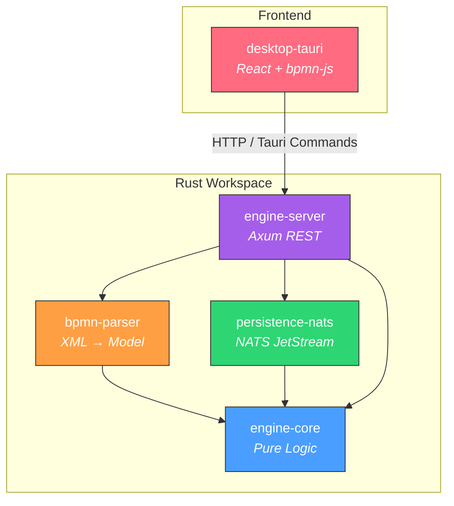
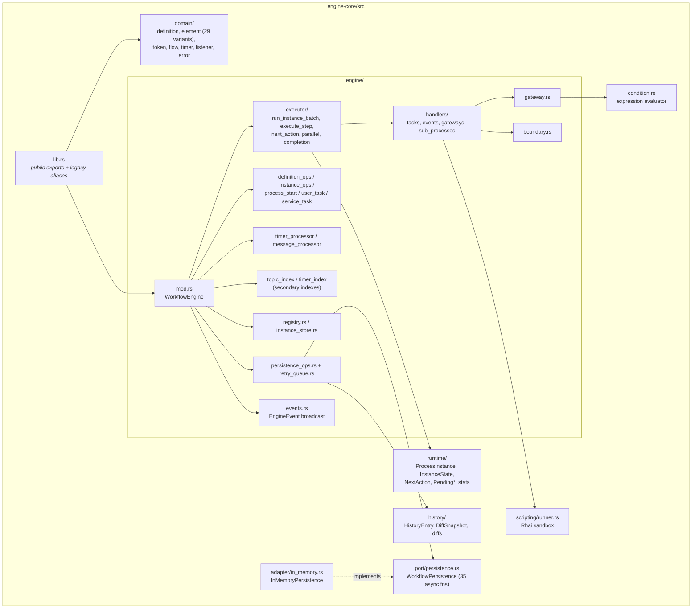
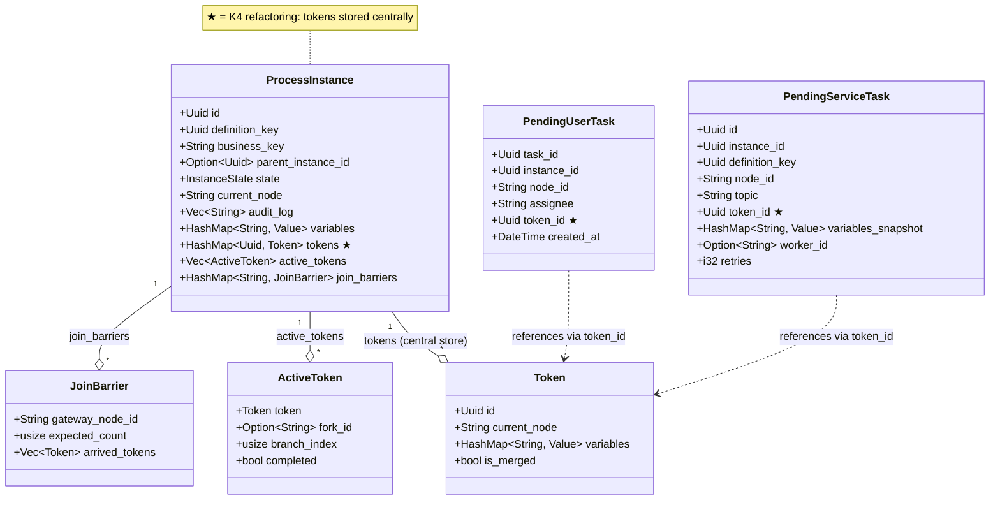
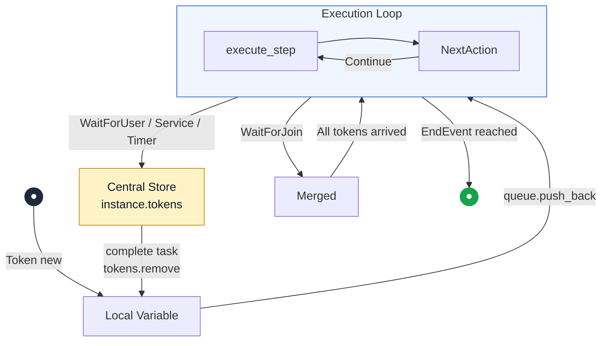
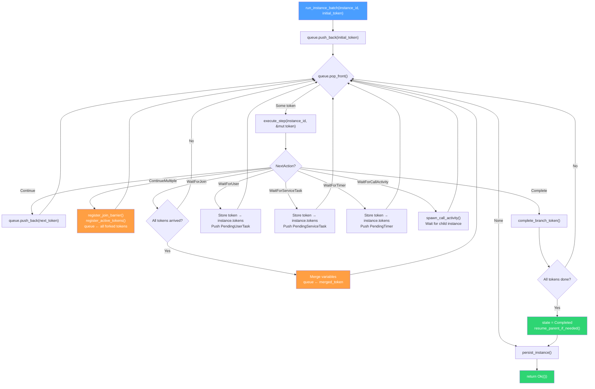
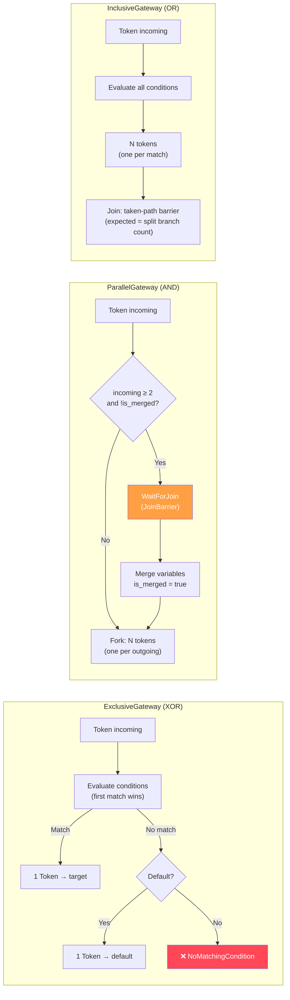
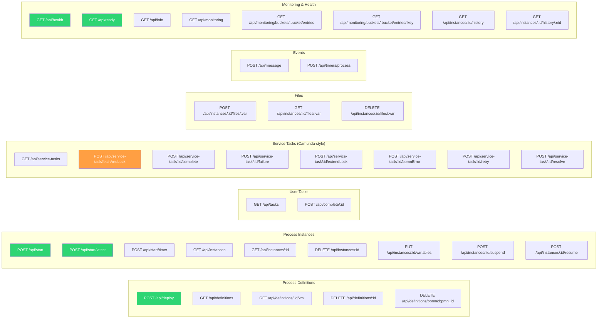
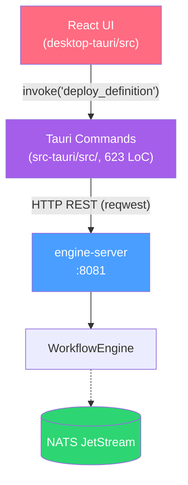

# bpmninja — Architecture Documentation

> BPMN 2.0 workflow engine in Rust, token-based execution
> As of: 2026-10-12 (synced with code; v0.7.24)

---

## 1. Workspace Overview

The project is a Cargo workspace with 6 crates, plus a Tauri desktop app, a TypeScript worker client, an API spec and a fuzz workspace:

| Crate | LoC (incl. tests) | Purpose |
|---|---|---|
| **engine-core** | ~19,100 | Pure state machine, token execution, gateways, scripting, history |
| **bpmn-parser** | ~3,040 | BPMN 2.0 XML → `ProcessDefinition` (quick-xml + serde) |
| **persistence-nats** | ~1,440 | `WorkflowPersistence` via NATS JetStream KV / Object Store / Streams |
| **persistence-memory** | ~120 | Re-export of `engine_core::adapter::InMemoryPersistence` |
| **engine-server** | ~6,740 | Axum REST API, SSE, timer scheduler, auth/CORS, startup restore |
| **agent-orchestrator** | ~130 | One-shot demo worker (not a production loop) |
| **desktop-tauri** | ~9,250 TS + ~1,130 Rust | Tauri + React + Tailwind + bpmn-js (thin client) |
| **external-task-client** | ~1,070 (+ tests) | TypeScript Camunda-style worker SDK |

### Workspace Dependency Graph



---

## 2. engine-core — Core Architecture

### 2.1 Module Structure



### 2.2 WorkflowEngine — Component Breakdown (K2)

The engine is split into focused components:

```rust
pub struct WorkflowEngine {
    pub(crate) definitions:              DefinitionRegistry,          // Arc<DashMap<Uuid, Arc<ProcessDefinition>>>
    pub(crate) instances:                InstanceStore,               // Arc<DashMap<Uuid, Arc<RwLock<ProcessInstance>>>>
    pub(crate) pending_user_tasks:       Arc<DashMap<Uuid, PendingUserTask>>,
    pub(crate) pending_service_tasks:    Arc<DashMap<Uuid, PendingServiceTask>>,
    pub(crate) service_task_topic_index: TopicIndex,                  // secondary: topic -> task ids
    pub(crate) pending_timers:           Arc<DashMap<Uuid, PendingTimer>>,
    pub(crate) timer_due_index:          TimerDueIndex,               // secondary: BTreeMap<(expires_at, id)>
    pub(crate) pending_message_catches:  Arc<DashMap<Uuid, PendingMessageCatch>>,
    pub(crate) persistence:              Option<Arc<dyn WorkflowPersistence>>,
    pub(crate) persistence_error_count:  Arc<AtomicU64>,
    pub(crate) retry_tx:                 Option<RetryQueueTx>,        // bounded mpsc
    pub(crate) retry_worker_handle:      Mutex<Option<JoinHandle<()>>>,
    pub(crate) script_config:            ScriptConfig,
    pub(crate) event_tx:                 broadcast::Sender<EngineEvent>,
}
```

| Component | Struct | Locking Strategy |
|---|---|---|
| **DefinitionRegistry** | `Arc<DashMap<Uuid, Arc<ProcessDefinition>>>` | Sharded map, definitions immutable after deploy |
| **InstanceStore** | `Arc<DashMap<Uuid, Arc<RwLock<ProcessInstance>>>>` | Sharded map + per-instance `RwLock` (K1) |
| **PendingTask queues** | `Arc<DashMap<Uuid, Pending*>>` | Sharded, concurrent O(1) ops |
| **Secondary indexes** | `TopicIndex`, `TimerDueIndex` | Derived from the queues (SSOT stays in the DashMaps) |

---

## 3. Data Model

### 3.1 ProcessInstance (after K4 refactoring)



### 3.2 BPMN Element Types

29 variants in `engine-core/src/domain/element.rs` (closed enum, exhaustive matching):

```rust
pub enum BpmnElement {
    // Start / end
    StartEvent,
    TimerStartEvent(TimerDefinition),             // Duration | AbsoluteDate | CronCycle | RepeatingInterval
    MessageStartEvent { message_name: String },
    EndEvent,
    TerminateEndEvent,
    ErrorEndEvent { error_code: String },
    EscalationEndEvent { escalation_code: String },
    CompensationEndEvent { activity_ref: Option<String> },
    // Tasks (multi_instance is always None — MI is rejected at parse time)
    ServiceTask { topic: String, multi_instance: Option<MultiInstanceDef> },
    UserTask(String),                             // assignee
    ScriptTask { script: String, multi_instance: Option<MultiInstanceDef> },
    SendTask { message_name: String, multi_instance: Option<MultiInstanceDef> },
    // Gateways
    ExclusiveGateway { default: Option<String> },
    InclusiveGateway,
    ParallelGateway,
    EventBasedGateway,
    ComplexGateway { join_condition: Option<String>, default: Option<String> },
    // Intermediate / boundary events
    TimerCatchEvent(TimerDefinition),
    MessageCatchEvent { message_name: String },
    EscalationThrowEvent { escalation_code: String },
    CompensationThrowEvent { activity_ref: Option<String> },
    BoundaryTimerEvent { attached_to: String, timer: TimerDefinition, cancel_activity: bool },
    BoundaryMessageEvent { attached_to: String, message_name: String, cancel_activity: bool },
    BoundaryErrorEvent { attached_to: String, error_code: Option<String> },
    BoundaryEscalationEvent { attached_to: String, escalation_code: Option<String>, cancel_activity: bool },
    BoundaryCompensationEvent { attached_to: String },
    // Sub-processes
    CallActivity { called_element: String },
    EmbeddedSubProcess { start_node_id: String },  // flattened at parse time
    SubProcessEndEvent { sub_process_id: String }, // synthetic end event
}
```

---

## 4. Execution Architecture

### 4.1 Token Lifecycle (K4)

Tokens exist in **exactly one place** at any moment in time:



> **Central store**: `instance.tokens: HashMap<Uuid, Token>` — pending tasks only hold `token_id: Uuid`.

### 4.2 Execution Loop (run_instance_batch)



### 4.3 Gateway Routing



Inclusive join is a taken-path barrier: after a matching split (`find_downstream_join`), `expected_count` is the number of branches actually taken. Unstructured joins without a matching split fall back to `incoming_flow_count`.

---

## 5. Persistence Architecture

### 5.1 WorkflowPersistence Trait

`engine-core/src/port/persistence.rs` defines **35 async methods**, grouped as:

| Group | Methods |
|---|---|
| Tokens | `save_token`, `load_tokens`, `delete_token` |
| Instances / Definitions | `save_instance`, `list_instances`, `delete_instance`, `save_definition`, `list_definitions`, `delete_definition` |
| Wait states | save / delete / list for user tasks, service tasks, timers, message catches |
| Files | `save_file`, `load_file`, `delete_file` |
| BPMN XML | `save_bpmn_xml`, `load_bpmn_xml`, `list_bpmn_xml_ids` |
| History | `append_history_entry`, `query_history` |
| Archive | `save_completed_instance`, `query_completed_instances`, `get_completed_instance` |
| Monitoring | `get_storage_info`, `get_bucket_entries`, `get_bucket_entry_detail` |

The full signature list lives in [knowledge-base/modules/engine-core/interfaces.md](knowledge-base/modules/engine-core/interfaces.md).

### 5.2 Implementations

| Backend | Crate | Storage |
|---|---|---|
| `InMemoryPersistence` | `persistence-memory` | `HashMap` + `Vec` (tests & dev) |
| `NatsPersistence` | `persistence-nats` | NATS JetStream KV + ObjectStore |

**NATS storage layout** (source: `persistence-nats/src/client.rs`, `trait_impl.rs`):

| Bucket / Store | Type | Contents | Key |
|---|---|---|---|
| `definitions` | KV | `ProcessDefinition` (JSON) | `{definition_uuid}` |
| `instances` | KV | Active `ProcessInstance` (JSON) | `{instance_uuid}` |
| `user_tasks` / `service_tasks` / `timers` / `messages` | KV | Pending wait states (JSON) | `{uuid}` |
| `tokens` | KV | `Token` (JSON) | `token-{instance_uuid}-{token_uuid}` |
| `history_instances` | KV | Archived (completed) instances | `{instance_uuid}` |
| `bpmn_xml` | Object Store | BPMN XML source | `{definition_uuid}` |
| `instance_files` | Object Store | File variables | `file:{instance}-{var}-{filename}` |
| `WORKFLOW_HISTORY` | Stream | `HistoryEntry`, subject `history.instance.{id}` | — |
| `WORKFLOW_EVENTS` | Stream | subjects `WORKFLOW_EVENTS.*` | — |
| `ENGINE_LOGS` | Stream | Log buffer backup (created by engine-server) | — |

### 5.3 Fault-Tolerant Retry Queue (K6)

Since NATS can experience outages, the engine uses a two-stage retry mechanism for stateful I/O operations:
1. **Inline retry**: short backoff (e.g. 50ms) on the direct call. On success, execution continues immediately.
2. **Bounded background retry queue**: if the inline retry fails (e.g. NATS is offline), a `PersistJob` is enqueued on a bounded channel (default capacity 10 000, env `PERSISTENCE_RETRY_QUEUE_CAPACITY`). A background worker re-reads the latest in-memory state and retries with *exponential backoff* (max 50 attempts). If the queue is full, jobs are **dropped** and counted (`bpmn_persistence_retry_dropped_total`) to avoid OOM under prolonged outage.
This prevents unbounded memory growth while still recovering from transient network failure.

---

## 6. REST API (engine-server)

> Complete OpenAPI 3.0 specification: **[docs/openapi.yaml](openapi.yaml)**

### 6.1 Route Overview (46 endpoints)



### 6.2 Server Architecture

```rust
pub struct AppState {
    pub(crate) engine:           Arc<WorkflowEngine>,                  // Shared engine (no outer lock)
    pub(crate) persistence:      Option<Arc<dyn WorkflowPersistence>>, // NATS backend if connected
    pub(crate) deployed_xml:     Arc<RwLock<HashMap<String, String>>>, // XML cache (definition key → XML)
    pub(crate) nats_url:         String,                               // For /api/info
    pub(crate) log_buffer:       Arc<LogBuffer>,
    pub(crate) require_nats:     bool,                                 // REQUIRE_NATS → readiness / durability
    pub(crate) max_upload_bytes: usize,                                // MAX_UPLOAD_BYTES (default 5 MiB)
    pub(crate) max_xml_bytes:    usize,                                // MAX_XML_BYTES (default 10 MiB)
    pub(crate) api_key:          Option<String>,                       // BPMNINJA_API_KEY; None = auth off
    pub(crate) cors_origins:     Vec<String>,                          // CORS_ORIGINS allowlist; "*" = any (dev)
}
```

> The server shares the engine only via `Arc<WorkflowEngine>`. Because all inner collections (`DashMap`, per-instance `RwLock`) are thread-safe and mutations go through `&self`, there is no longer a monolithic read/write lock over the entire engine. This eliminates contention under heavy HTTP traffic. Instances are isolated via **K1 (per-instance locking)** through `InstanceStore`.

### 6.3 Background Timer Scheduler

The server spawns a Tokio background task that periodically calls `engine.process_timers()`:

```rust
// main.rs — automatic timer polling (lock-free via Arc<WorkflowEngine>)
let timer_interval_ms: u64 = env::var("TIMER_INTERVAL_MS")
    .ok().and_then(|v| v.parse().ok()).unwrap_or(1000);

tokio::spawn(async move {
    loop {
        tokio::time::sleep(Duration::from_millis(timer_interval_ms)).await;
        match timer_engine.process_timers().await {
            Ok(n) => tracing::info!("Timer scheduler: processed {} expired timer(s)", n),
            Err(e) => tracing::warn!("Timer scheduler error: {}", e),
        }
    }
});
```

> **Configuration**: `TIMER_INTERVAL_MS` (default: 1000ms). No external cron required.

### 6.4 Health & Readiness

| Endpoint | Function | Check |
|----------|----------|-------|
| `GET /api/health` | Liveness probe | Always `200 OK` when the server is running |
| `GET /api/ready` | Readiness probe | `503` if `REQUIRE_NATS` is set but no persistence is configured, or if NATS storage check fails; otherwise `200` |

`REQUIRE_NATS` defaults to true so a missing NATS backend fails startup instead of silently running in-memory. Set `REQUIRE_NATS=false` only for ephemeral local runs.

---

## 7. Desktop App (Tauri)

### 7.1 Frontend Components

| File | LoC | Purpose |
|---|---|---|
| `App.tsx` | ~180 | Main layout, tab navigation (7 tabs), timer-start detection |
| `ModelerPage.tsx` | ~350 | bpmn-js modeler with deploy, start & variable dialog |
| `InstancesPage.tsx` | ~245 | Instance list (grouped by definition), suspend icon |
| `InstanceDetailDialog.tsx` | ~345 | Instance details with suspend/resume button, timer cycle banner, auto-refresh |
| `InstanceViewer.tsx` | ~125 | Read-only BPMN viewer with active node highlighting + timer pulse |
| `HistoryTimeline.tsx` | ~225 | Event table with filters, detail dialog, diff display |
| `DeployedProcessesPage.tsx` | ~330 | Version grouping, accordion, cascade delete |
| `VariableEditor.tsx` | ~480 | Typed editor (6 types including file), upload/download |
| `MonitoringPage.tsx` | ~365 | Metric cards, NATS storage breakdown, KV browser, auto-refresh |
| `PendingTasksPage.tsx` | ~290 | User & service task lists with completion dialogs |
| `IncidentsPage.tsx` | ~165 | Incident cards with quick retry, detail link, auto-refresh |
| `IncidentDetailDialog.tsx` | ~160 | Retry (configurable retries) + resolve (with VariableEditor) |
| `SettingsPage.tsx` | ~165 | API URL config + connection verify |
| `ErrorBoundary.tsx` | ~72 | React error boundary |
| `MessageDialog.tsx` | ~93 | Message correlation dialog |
| `lib/tauri.ts` | ~170 | All Tauri command wrappers (typed API layer) |
| Custom Properties | ~290 | Condition, script, topic extensions for bpmn-js |
| `index.css` | ~165 | TailwindCSS + HSL design token variables |

### 7.2 Thin-Client Architecture

The desktop app operates as a **thin client** — all workflow logic lives in `engine-server`.



> **Configuration**: `ENGINE_API_URL` environment variable (default: `http://localhost:8081`).

---

## 8. Concurrency & Locking (K1)

### 8.1 Lock Hierarchy

```
WorkflowEngine (Arc)
├── DefinitionRegistry       → Arc<DashMap>                  (sharded)
├── InstanceStore             → Arc<DashMap>                  (sharded map)
│   └── ProcessInstance[i]   → Arc<RwLock<ProcessInstance>>  (per-instance lock!)
├── pending_user_tasks       → Arc<DashMap>                  (lock-free / sharded)
├── pending_service_tasks    → Arc<DashMap>                  (lock-free / sharded)
├── pending_timers           → Arc<DashMap>                  (lock-free / sharded)
└── pending_message_catches  → Arc<DashMap>                  (lock-free / sharded)
```

### 8.2 Deadlock Prevention Pattern

```rust
// ❌ FORBIDDEN: hold a lock across .await
let inst = instance_arc.write().await;
self.some_async_method().await;  // DEADLOCK!

// ✅ CORRECT: lock scoped before .await
{
    let mut inst = instance_arc.write().await;
    inst.state = InstanceState::Running;
}  // Lock dropped
self.some_async_method().await;  // Safe!
```

---

## 9. History & Audit Trail

Every state transition is stored as a `HistoryEntry`:

| Field | Type | Description |
|---|---|---|
| `event_type` | `HistoryEventType` | InstanceStarted, TaskCompleted, TokenForked, ... |
| `diff` | `Option<HistoryDiff>` | Automatically computed diff (variables, status, node) |
| `actor_type` | `ActorType` | Engine, User, ServiceWorker, Timer, Listener |
| `full_state_snapshot` | `Option<Value>` | Snapshot every 8 audit entries |

**Diff calculation:** `calculate_diff(old: &ProcessInstance, new: &ProcessInstance) → HistoryDiff`
- Variable diff: added, removed, changed (with value truncation >1KB)
- Status diff: "Running → Completed"
- Node diff: "task1 → end"
- File upload detection: "File 'report.pdf' uploaded (1.2 MB)"

---

## 10. Code Statistics

> As of: 2026-10-12 — measured via `wc -l` (Rust totals include inline/test modules) and by counting test attributes

| Area | Files | LOC |
|---|---|---|
| engine-core | 74 | ~19,100 |
| bpmn-parser | 4 | ~3,040 |
| persistence-nats | 5 | ~1,440 |
| persistence-memory | 1 | ~120 |
| engine-server (lib + E2E tests) | 37 | ~6,740 |
| agent-orchestrator | 1 | ~130 |
| desktop-tauri (TypeScript) | 63 | ~9,250 |
| desktop-tauri (Rust backend) | — | ~1,130 |
| external-task-client (lib) | — | ~1,070 |
| fuzz targets | 9 | ~710 |

### Test Overview (approximate)

| Crate | Unit | E2E / Integration | Total |
|---|---|---|---|
| engine-core | ~247 | 5 | ~252 |
| bpmn-parser | ~46 | — | ~46 |
| persistence-nats | 4 | — | 4 |
| engine-server | ~15 | ~70 | ~85 |
| desktop-tauri (Playwright) | — | 52 | 52 |
| external-task-client (Vitest) | 76 | — | 76 |

Source of truth: `cargo test --workspace`.
