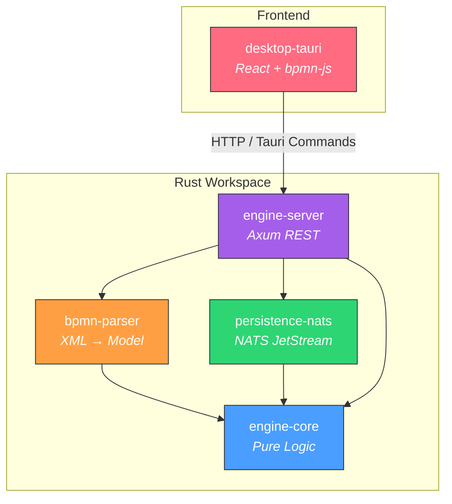
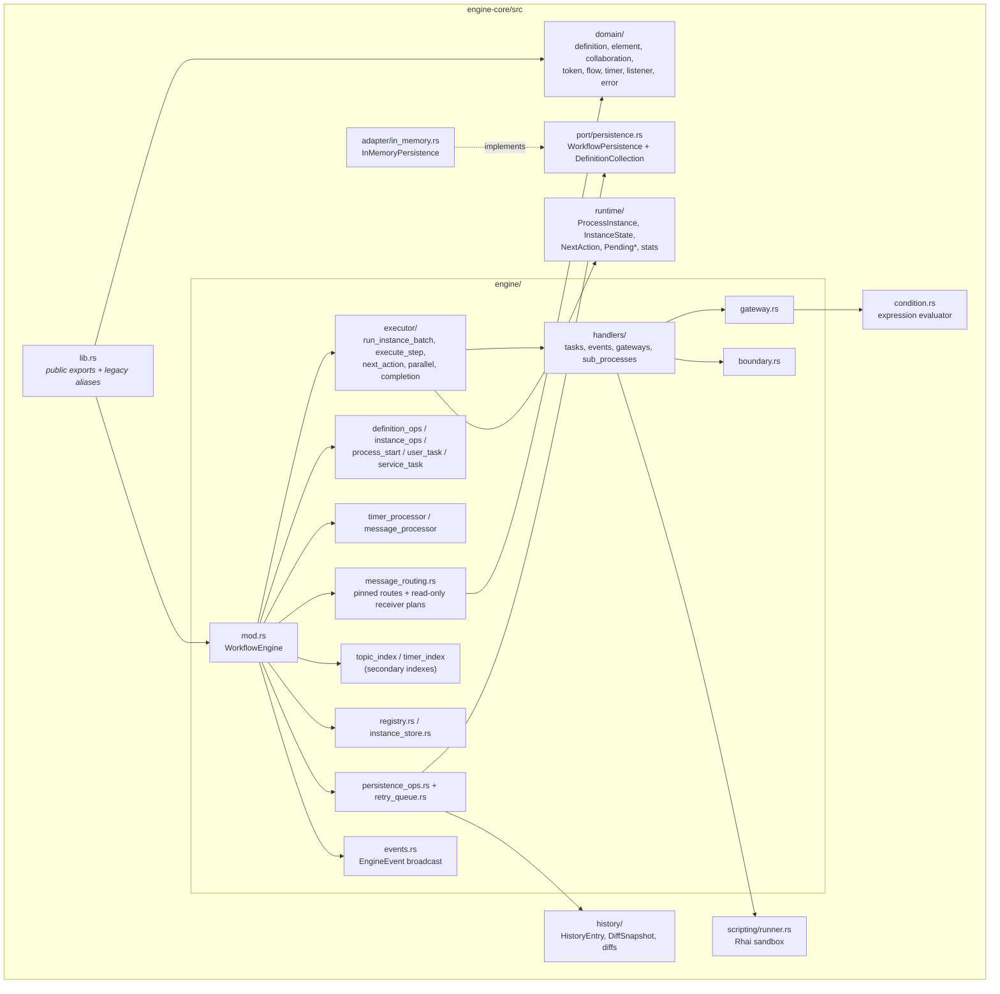
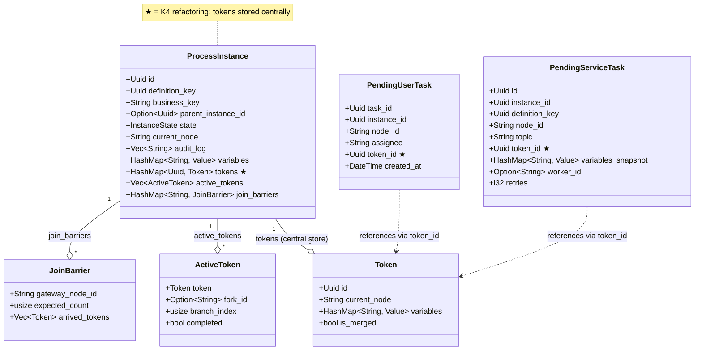
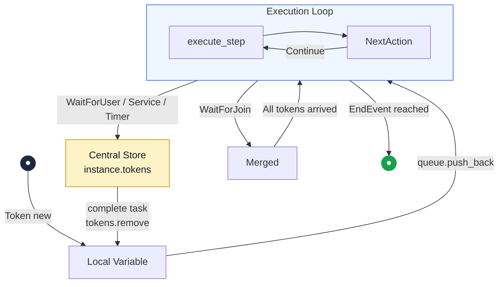
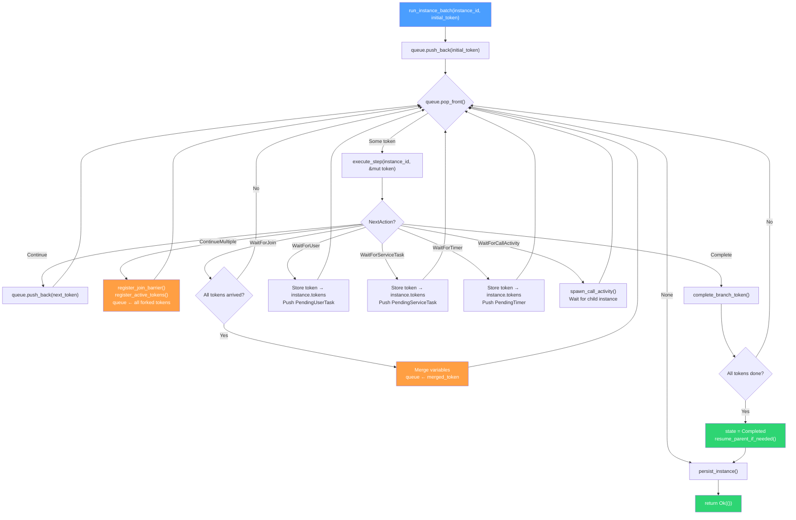
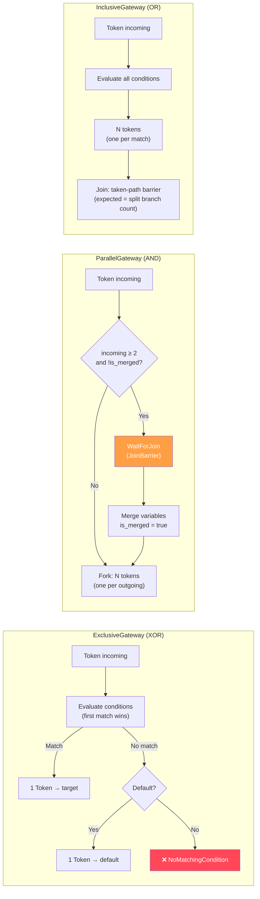
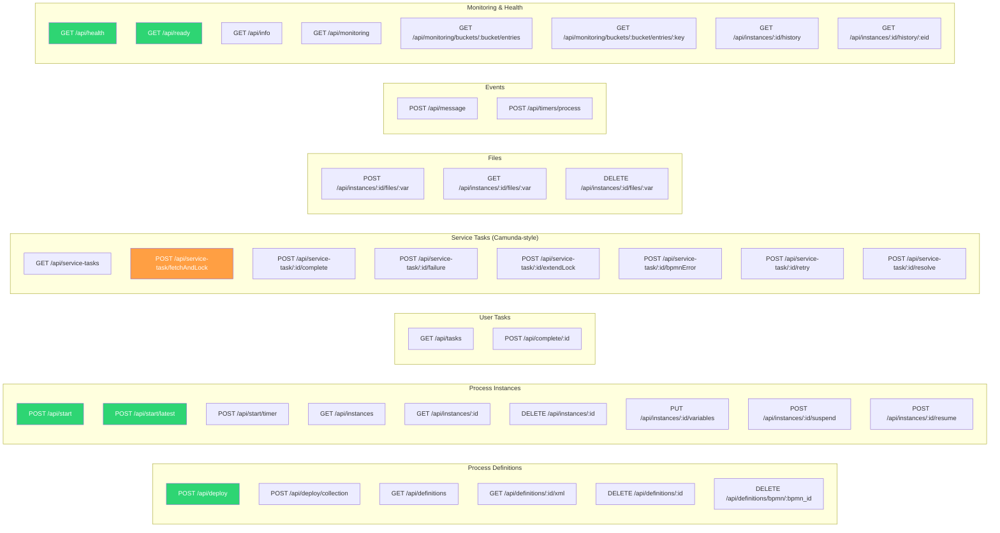
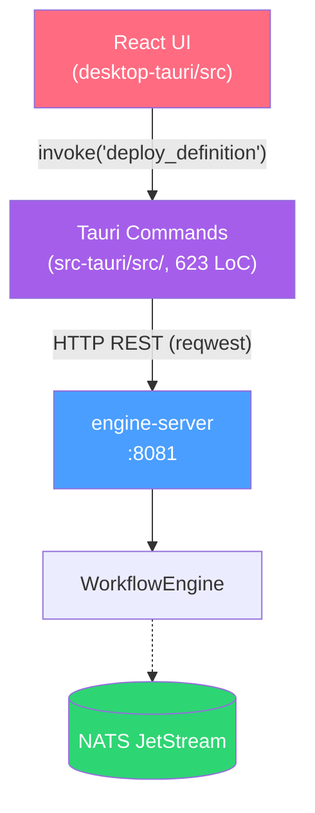

# bpmninja — Architecture Documentation

> BPMN 2.0 workflow engine in Rust, token-based execution
> As of: 2026-10-27 (collection deployment and routing preflight; v0.7.24)

---

## 1. Workspace Overview

The project is a Cargo workspace with 6 crates, plus a Tauri desktop app, a TypeScript worker client, an API spec and a fuzz workspace:

| Component | Purpose |
|---|---|
| **engine-core** | Token execution, shared collaboration types, atomic definition publication, receiver preflight, scripting and history |
| **bpmn-parser** | BPMN XML → single process, executable process collection and validated collaboration metadata |
| **persistence-nats** | `WorkflowPersistence` adapter using JetStream KV, Object Stores and Streams |
| **persistence-memory** | Re-export of `engine_core::adapter::InMemoryPersistence` for tests/local development |
| **engine-server** | Axum REST, per-pool model checking, SSE, timers, auth/CORS and startup restoration |
| **agent-orchestrator** | One-shot demo external worker |
| **desktop-tauri** | Tauri + React + bpmn-js thin client; current deploy workflow uses the single-process endpoint |
| **bpmn-ninja-external-task-client** | TypeScript external service-task worker SDK |

### Workspace Dependency Graph



---

## 2. engine-core — Core Architecture

### 2.1 Module Structure



### 2.2 WorkflowEngine — Component Breakdown (K2)

The engine is split into focused components. This excerpt shows selected fields; the complete struct is in [engine/mod.rs](../engine-core/src/engine/mod.rs):

```rust
pub struct WorkflowEngine {
    pub(crate) deployment_lock:          tokio::sync::Mutex<()>,
    pub(crate) internal_routes:          std::sync::RwLock<HashMap<Uuid, Vec<PinnedMessageRoute>>>,
    pub(crate) definitions:              DefinitionRegistry,          // Arc<std::sync::RwLock<HashMap<Uuid, Arc<ProcessDefinition>>>>
    pub(crate) instances:                InstanceStore,               // Arc<DashMap<Uuid, Arc<RwLock<ProcessInstance>>>>
    pub(crate) pending_user_tasks:       Arc<DashMap<Uuid, PendingUserTask>>,
    pub(crate) pending_service_tasks:    Arc<DashMap<Uuid, PendingServiceTask>>,
    pub(crate) service_task_topic_index: TopicIndex,                  // secondary: topic -> task ids
    pub(crate) pending_timers:           Arc<DashMap<Uuid, PendingTimer>>,
    pub(crate) timer_due_index:          TimerDueIndex,               // secondary: BTreeMap<(expires_at, id)>
    pub(crate) pending_message_catches:  Arc<DashMap<Uuid, PendingMessageCatch>>,
    pub(crate) persistence:              Option<Arc<dyn WorkflowPersistence>>,
    pub(crate) persistence_error_count:  Arc<AtomicU64>,
    pub(crate) retry_tx:                 Option<RetryQueueTx>,        // bounded mpsc
    pub(crate) retry_worker_handle:      Mutex<Option<JoinHandle<()>>>,
    pub(crate) scripts:                  ScriptRunner,
    pub(crate) event_tx:                 broadcast::Sender<EngineEvent>,
}
```

| Component | Struct | Locking Strategy |
|---|---|---|
| **DefinitionRegistry** | `Arc<std::sync::RwLock<HashMap<Uuid, Arc<ProcessDefinition>>>>` | Short synchronous read/write guards; all definitions in a collection become visible in one write |
| **Deployment serialization** | `tokio::sync::Mutex<()>` | Serializes single/collection version allocation and deletion |
| **Internal route index** | `std::sync::RwLock<HashMap<Uuid, Vec<PinnedMessageRoute>>>` | Routes indexed by immutable source definition key; cloned before async receiver inspection |
| **InstanceStore** | `Arc<DashMap<Uuid, Arc<RwLock<ProcessInstance>>>>` | Sharded map + per-instance `RwLock` (K1) |
| **PendingTask queues** | `Arc<DashMap<Uuid, Pending*>>` | Sharded, concurrent O(1) ops |
| **Secondary indexes** | `TopicIndex`, `TimerDueIndex` | Derived from the queues (SSOT stays in the DashMaps) |

---

## 3. Data Model

### 3.1 ProcessInstance (after K4 refactoring)



### 3.2 BPMN Element Types

The closed `BpmnElement` enum is defined in
[domain/element.rs](../engine-core/src/domain/element.rs). It includes plain,
message, timer, signal and conditional starts; task and gateway execution;
message, signal and conditional catches; boundary events; and subprocess nodes.
The parser's [element matrix](knowledge-base/modules/bpmn-parser/element-matrix.md)
is the source for supported XML forms and explicit rejection rules.

Multi-instance and standard-loop characteristics are runtime-supported on task
and call-activity nodes. Event-subprocess subscriptions, activation generations
and conditional waits are stored with instance state; see [event subprocesses](event-subprocesses.md),
[conditional catches](conditional-catches.md), [boundaries](boundary-conditional-catches.md)
and [starts](conditional-starts.md).

### 3.3 Collaboration and Routing Model

`domain/collaboration.rs` owns `Collaboration`, `Participant`, `MessageFlow` and
`MessageEndpoint`; `bpmn-parser` re-exports the same types. `CollaborationDocument`
contains executable definitions plus validated metadata. `DefinitionCollection`
is the persistence commit record: collection UUID, flattened definitions with
exact keys/versions, original XML, collaboration metadata and deleted-member IDs.

`compile_routes` resolves metadata only against its committed collection, producing
`PinnedMessageRoute` values with deployed source/target endpoints. Each endpoint
retains participant, process, element, definition key and version. Compilation
runs before persistence and again before publishing a restored collection.

---

## 4. Execution Architecture

### 4.1 Token Lifecycle (K4)

Tokens exist in **exactly one place** at any moment in time:



> **Central store**: `instance.tokens: HashMap<Uuid, Token>` — pending tasks only hold `token_id: Uuid`.

### 4.2 Execution Loop (run_instance_batch)



### 4.3 Gateway Routing



Inclusive join is a taken-path barrier: after a matching split (`find_downstream_join`), `expected_count` is the number of branches actually taken. Unstructured joins without a matching split fall back to `incoming_flow_count`.

---

## 5. Persistence Architecture

### 5.1 WorkflowPersistence Trait

`engine-core/src/port/persistence.rs` defines the persistence port, grouped as:

| Group | Methods |
|---|---|
| Tokens | `save_token`, `load_tokens`, `delete_token` |
| Instances / Definitions | `save_instance`, `list_instances`, `delete_instance`, `save_definition`, `list_definitions`, `delete_definition` |
| Collections | `save_definition_collection`, `list_definition_collections`; atomic commit support is opt-in and fails closed by default |
| Conditional starts | Durable reservation, lookup and completion of explicit start receipts |
| Wait states | save / delete / list for user tasks, service tasks, timers, message catches |
| Files | `save_file`, `load_file`, `delete_file` |
| BPMN XML | `save_bpmn_xml`, `load_bpmn_xml`, `list_bpmn_xml_ids` |
| History | `append_history_entry`, `query_history` |
| Archive | `save_completed_instance`, `query_completed_instances`, `get_completed_instance` |
| Monitoring | `get_storage_info`, `get_bucket_entries`, `get_bucket_entry_detail` |

The authoritative signatures are in [port/persistence.rs](../engine-core/src/port/persistence.rs); the [interface overview](knowledge-base/modules/engine-core/interfaces.md) provides additional context.

### 5.2 Implementations

| Backend | Crate | Storage |
|---|---|---|
| `InMemoryPersistence` | `persistence-memory` | `HashMap` + `Vec` (tests & dev) |
| `NatsPersistence` | `persistence-nats` | NATS JetStream KV + ObjectStore |

**NATS storage layout** (source: `persistence-nats/src/client.rs`, `trait_impl.rs`):

| Bucket / Store | Type | Contents | Key |
|---|---|---|---|
| `definitions` | KV | Individually persisted legacy process definitions | `{definition_uuid}` |
| `definition_collections` | KV | Complete batch commit: definitions, XML, metadata and deletion tombstones | `{collection_uuid}` |
| `conditional_starts` | KV | Durable explicit conditional-start receipts | `{request_uuid}` |
| `instance_audit` / `instance_states` | KV | Detached audit snapshots and checkpoint/delta records when configured | Content-addressed / instance state keys |
| `instances` | KV | Active `ProcessInstance` (JSON) | `{instance_uuid}` |
| `user_tasks` / `service_tasks` / `timers` / `messages` | KV | Pending wait states (JSON) | `{uuid}` |
| `tokens` | KV | `Token` (JSON) | `token-{instance_uuid}-{token_uuid}` |
| `history_instances` | KV | Archived (completed) instances | `{instance_uuid}` |
| `bpmn_xml` | Object Store | BPMN XML source | `{definition_uuid}` |
| `instance_files` | Object Store | File variables | `file:{instance}-{var}-{filename}` |
| `WORKFLOW_HISTORY` | Stream | `HistoryEntry`, subject `history.instance.{id}` | — |
| `WORKFLOW_EVENTS` | Stream | subjects `WORKFLOW_EVENTS.*` | — |
| `ENGINE_LOGS` | Stream | Log buffer backup (created by engine-server) | — |

### 5.3 Fault-Tolerant Retry Queue (K6)

Since NATS can experience outages, the engine uses a two-stage retry mechanism for stateful I/O operations:
1. **Inline retry**: short backoff (e.g. 50ms) on the direct call. On success, execution continues immediately.
2. **Bounded background retry queue**: if the inline retry fails (e.g. NATS is offline), a `PersistJob` is enqueued on a bounded channel (default capacity 10 000, env `PERSISTENCE_RETRY_QUEUE_CAPACITY`). A background worker re-reads the latest in-memory state and retries with *exponential backoff* (max 50 attempts). If the queue is full, jobs are **dropped** and counted (`bpmn_persistence_retry_dropped_total`) to avoid OOM under prolonged outage.
This prevents unbounded memory growth while still recovering from transient network failure.

---

### 5.4 Collection Commit and Recovery

`POST /api/deploy/collection` parses all explicitly executable top-level pools
with `parse_bpmn_collaboration`. Every selected process must validate; model
checking runs on each isolated pool with shared declarations. Enforce-mode
violations reject the batch before any definition is published. Skipped and
inconclusive reports retain the existing model-check policy.

```mermaid
sequenceDiagram
    participant Client
    participant Server as engine-server
    participant Parser as bpmn-parser
    participant Engine as WorkflowEngine
    participant Store as WorkflowPersistence
    Client->>Server: POST /api/deploy/collection
    Server->>Parser: parse_bpmn_collaboration(xml)
    Parser-->>Server: executable processes + collaborations
    loop Each executable pool
        Server->>Server: isolated model check
    end
    Server->>Engine: deploy_collection(processes, xml, metadata)
    Engine->>Engine: serialize versions; flatten definitions; compile pinned routes
    opt Persistence configured
        Engine->>Store: save_definition_collection(one complete record)
        Store-->>Engine: durable commit acknowledgment
    end
    Engine->>Engine: install routes; publish definitions under one registry write
    Engine-->>Server: committed collection
    Server-->>Client: collection_id + ordered process results + collaborations
```

NATS commits one KV record in `definition_collections`; the memory adapter stores
one record under its collection lock. A definitive validation/commit failure
publishes no pools and queues no background deployment retry. The original
single-process endpoint retains its response and legacy persistence behavior.
Collection records must fit the broker message payload limit. Deployment version
allocation assumes one engine writer per store. A lost acknowledgment can leave a
committed batch to be recovered at restart; deployments have no client idempotency
key, so recover and inspect definitions before retrying.

Startup reads collection records, restores individual JSON definitions without
renumbering, and validates/reconstructs each collection's routes and active members
before restoring instances and wait states. XML reparsing is a legacy fallback,
not collection recovery. Invalid/unreadable collection records abort restoration.
Deleted members stay tombstoned in the original record and cannot resurrect;
collection XML is resolved from that record.

### 5.5 Version-Pinned Receiver Preflight

`plan_internal_messages(source_definition, source_element, business_key, variables)`
is an engine-only, read-only API. It uses only explicit flows from the source's
collection, retaining exact target key/version and catch/start element. The
business key must be nonempty and match instance metadata exactly; the explicit
payload snapshot is copied independently for each outgoing flow.

Each flow, in document order, returns `Start`, an exact `Catch` identity
(instance/catch/token), or `Unavailable` (deleted definition, no matching catch,
or ambiguous matches). Candidate filtering excludes other pools/versions,
signals, suspended/completed/missing receivers and stale wait occurrences.
Gateway alternatives and boundary subscriptions must match their live occurrence.
There is no latest-version or name-based fallback.

Preflight creates no instances, consumes no catches and reserves no receivers.
Public `correlate_message` retains its separate broadcast behavior. Automatic
internal sends await durable sender outbox records, occurrence identities,
receiver claims/deduplication and crash-point recovery. See the
[X12 contract](x12-collaboration-plan.md) for current limits and remaining gates.

---

## 6. REST API (engine-server)

> Complete OpenAPI 3.0 specification: **[docs/openapi.yaml](openapi.yaml)**

### 6.1 Selected Routes (see OpenAPI for the full contract)



### 6.2 Server Architecture

```rust
pub struct AppState {
    pub(crate) engine:           Arc<WorkflowEngine>,                  // Shared engine (no outer lock)
    pub(crate) persistence:      Option<Arc<dyn WorkflowPersistence>>, // NATS backend if connected
    pub(crate) deployed_xml:     Arc<RwLock<HashMap<String, String>>>, // XML cache (definition key → XML)
    pub(crate) nats_url:         String,                               // For /api/info
    pub(crate) log_buffer:       Arc<LogBuffer>,
    pub(crate) require_nats:     bool,                                 // REQUIRE_NATS → readiness / durability
    pub(crate) max_upload_bytes: usize,                                // MAX_UPLOAD_BYTES (default 5 MiB)
    pub(crate) max_xml_bytes:    usize,                                // MAX_XML_BYTES (default 10 MiB)
    pub(crate) api_key:          Option<String>,                       // BPMNINJA_API_KEY; None = auth off
    pub(crate) cors_origins:     Vec<String>,                          // CORS_ORIGINS allowlist; "*" = any (dev)
}
```

> The server shares the engine only via `Arc<WorkflowEngine>`. Because all inner collections (`DashMap`, per-instance `RwLock`) are thread-safe and mutations go through `&self`, there is no longer a monolithic read/write lock over the entire engine. Collection publication uses a short registry write lock; version allocation uses the deployment mutex. Instances are isolated via **K1 (per-instance locking)** through `InstanceStore`.

### 6.3 Background Timer Scheduler

The server spawns a Tokio background task that sleeps until the next timer is due and then calls `engine.process_timers()`:

```rust
// main.rs — event-driven timer scheduler (shared Arc<WorkflowEngine>)
let max_idle = Duration::from_millis(timer_interval_ms); // TIMER_INTERVAL_MS, default 1000
loop {
    tokio::select! {
        // Wakes at the earliest due time (TimerDueIndex), when a timer is added
        // (Notify), or after max_idle — whichever comes first.
        _ = timer_engine.wait_for_timer_work(max_idle) => {
            match timer_engine.process_timers().await { /* log */ }
        }
        _ = shutdown_rx.changed() => break,
    }
}
```

> **Configuration**: `TIMER_INTERVAL_MS` (default: 1000ms) is the **maximum idle wait**, not a polling period. Timers fire at their due time. Overdue timers that do not fire (suspended instances) are re-checked at most every `TIMER_INTERVAL_MS`. No external cron required.

### 6.4 Health & Readiness

| Endpoint | Function | Check |
|----------|----------|-------|
| `GET /api/health` | Liveness probe | Always `200 OK` when the server is running |
| `GET /api/ready` | Readiness probe | `503` if `REQUIRE_NATS` is set but no persistence is configured, or if NATS storage check fails; otherwise `200` |

`REQUIRE_NATS` defaults to true so a missing NATS backend fails startup instead of silently running in-memory. Set `REQUIRE_NATS=false` only for ephemeral local runs.

---

## 7. Desktop App (Tauri)

### 7.1 Frontend Components

| File | LoC | Purpose |
|---|---|---|
| `App.tsx` | ~180 | Main layout, tab navigation (7 tabs), timer-start detection |
| `ModelerPage.tsx` | ~350 | bpmn-js modeler with deploy, start & variable dialog |
| `InstancesPage.tsx` | ~245 | Instance list (grouped by definition), suspend icon |
| `InstanceDetailDialog.tsx` | ~345 | Instance details with suspend/resume button, timer cycle banner, auto-refresh |
| `InstanceViewer.tsx` | ~125 | Read-only BPMN viewer with active node highlighting + timer pulse |
| `HistoryTimeline.tsx` | ~225 | Event table with filters, detail dialog, diff display |
| `DeployedProcessesPage.tsx` | ~330 | Version grouping, accordion, cascade delete |
| `VariableEditor.tsx` | ~480 | Typed editor (6 types including file), upload/download |
| `MonitoringPage.tsx` | ~365 | Metric cards, NATS storage breakdown, KV browser, auto-refresh |
| `PendingTasksPage.tsx` | ~290 | User & service task lists with completion dialogs |
| `IncidentsPage.tsx` | ~165 | Incident cards with quick retry, detail link, auto-refresh |
| `IncidentDetailDialog.tsx` | ~160 | Retry (configurable retries) + resolve (with VariableEditor) |
| `SettingsPage.tsx` | ~165 | API URL config + connection verify |
| `ErrorBoundary.tsx` | ~72 | React error boundary |
| `MessageDialog.tsx` | ~93 | Message correlation dialog |
| `lib/tauri.ts` | ~170 | All Tauri command wrappers (typed API layer) |
| Custom Properties | ~290 | Condition, script, topic extensions for bpmn-js |
| `index.css` | ~165 | TailwindCSS + HSL design token variables |

### 7.2 Thin-Client Architecture

The desktop app operates as a **thin client** — all workflow logic lives in `engine-server`.



> **Configuration**: `ENGINE_API_URL` environment variable (default: `http://localhost:8081`).

---

## 8. Concurrency & Locking (K1)

### 8.1 Lock Hierarchy

```
WorkflowEngine (Arc)
├── deployment_lock         → tokio::sync::Mutex<()>         (deploy/delete/version allocation)
├── DefinitionRegistry       → Arc<std::sync::RwLock<HashMap>> (atomic collection publication)
├── internal_routes          → std::sync::RwLock<HashMap>      (source-key route index)
├── InstanceStore             → Arc<DashMap>                  (sharded map)
│   └── ProcessInstance[i]   → Arc<RwLock<ProcessInstance>>  (per-instance lock!)
├── pending_user_tasks       → Arc<DashMap>                  (sharded locking)
├── pending_service_tasks    → Arc<DashMap>                  (sharded locking)
├── pending_timers           → Arc<DashMap>                  (sharded locking)
└── pending_message_catches  → Arc<DashMap>                  (sharded locking)
```

### 8.2 Deadlock Prevention Pattern

Snapshot values and drop `DashMap`, registry and route-index guards before awaiting.
Release per-instance guards before calling async methods that may reacquire the
same instance lock. The deployment mutex intentionally spans the durable commit;
ordinary receiver preflight does not hold it while inspecting instances.

```rust
// ❌ Unsafe if the awaited method reacquires this instance lock
let inst = instance_arc.write().await;
self.some_async_method().await;  // DEADLOCK!

// ✅ CORRECT: lock scoped before .await
{
    let mut inst = instance_arc.write().await;
    inst.state = InstanceState::Running;
}  // Lock dropped
self.some_async_method().await;  // Safe!
```

---

## 9. History & Audit Trail

Every state transition is stored as a `HistoryEntry`:

| Field | Type | Description |
|---|---|---|
| `event_type` | `HistoryEventType` | InstanceStarted, TaskCompleted, TokenForked, ... |
| `diff` | `Option<HistoryDiff>` | Automatically computed diff (variables, status, node) |
| `actor_type` | `ActorType` | Engine, User, ServiceWorker, Timer, Listener |
| `full_state_snapshot` | `Option<Value>` | Snapshot every 8 audit entries |

**Diff calculation:** `calculate_diff(old: &ProcessInstance, new: &ProcessInstance) → HistoryDiff`
- Variable diff: added, removed, changed (with value truncation >1KB)
- Status diff: "Running → Completed"
- Node diff: "task1 → end"
- File upload detection: "File 'report.pdf' uploaded (1.2 MB)"

---

## 10. Verification Snapshot

As of 2026-10-27, the X12 verification run passed the following **subset**, not a
complete workspace or frontend suite:

| Suite | Passed |
|---|---:|
| engine-core library | 410 |
| bpmn-parser library | 99 |
| engine-server library | 29 |
| Collection deployment/routing integration | 7 |
| **Verified subset** | **545** |

The eight routing unit tests were rerun on the final implementation. Tests cover
correlation, exact versions/elements, ambiguity, stale jobs, gateway and boundary
occurrences, and side-effect-free planning. Isolated real JetStream tests cover
commit failure, disk restart, tombstones, malformed records and route pinning
after redeployment. Collection recovery tests require `nats-server` on PATH.

Strict Clippy passed for engine-core, bpmn-parser, persistence-nats and
engine-server with `--all-targets -- -D warnings`. TypeSpec compilation,
formatting, whitespace checks and AST-only graphify update passed. Full-suite
results remain in CI; use `cargo test --workspace` for Rust and the package scripts
for frontend/worker checks. Source paths and contracts take precedence over
historical line counts or copied enum/method totals.
