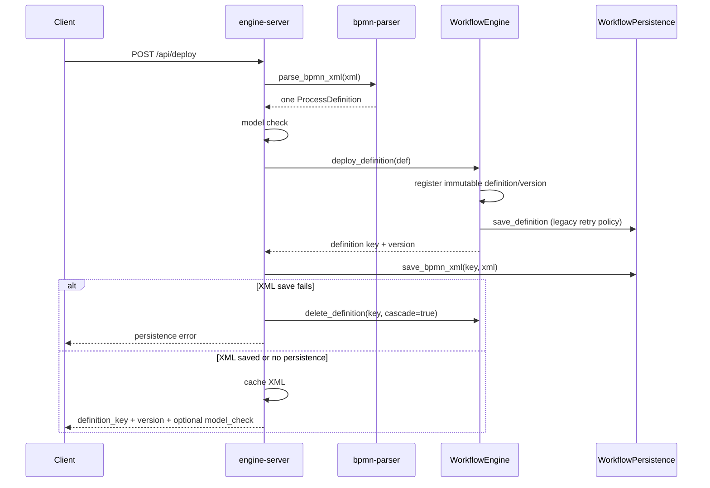
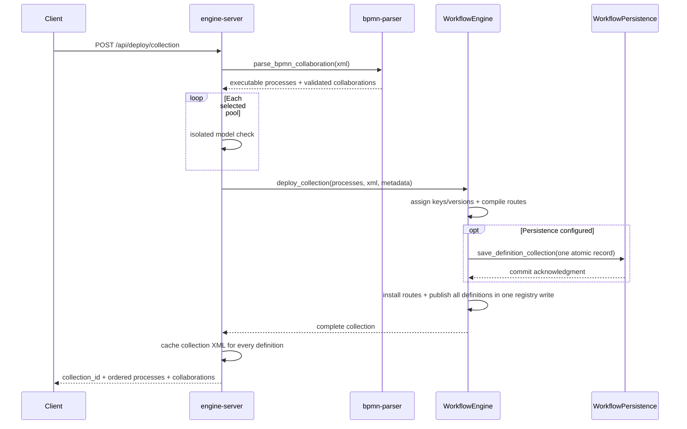
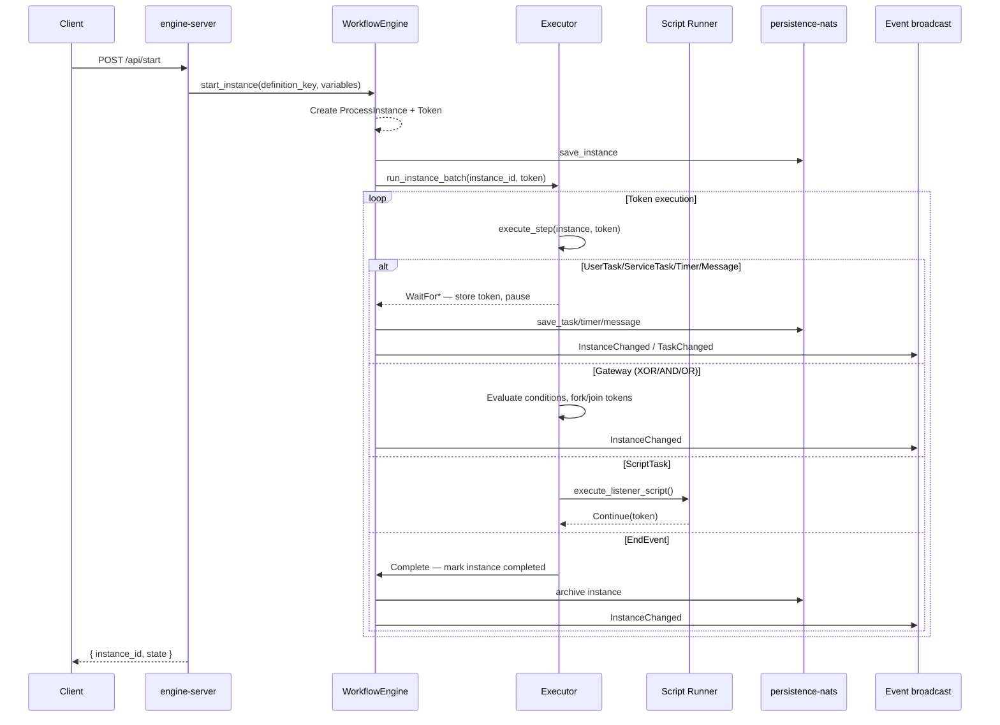
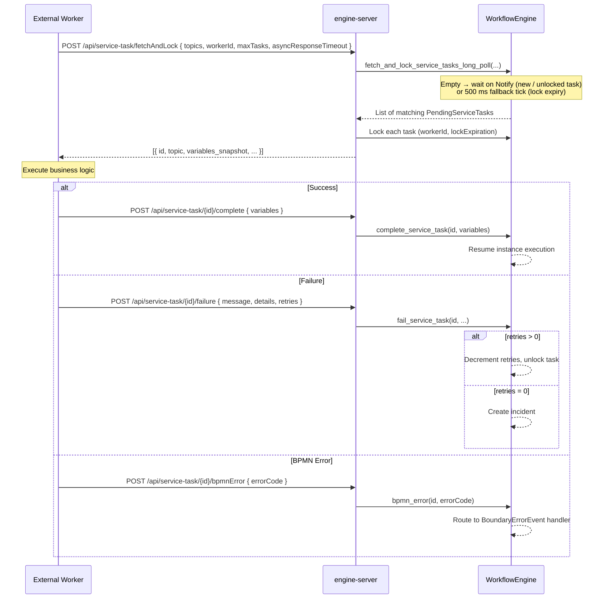
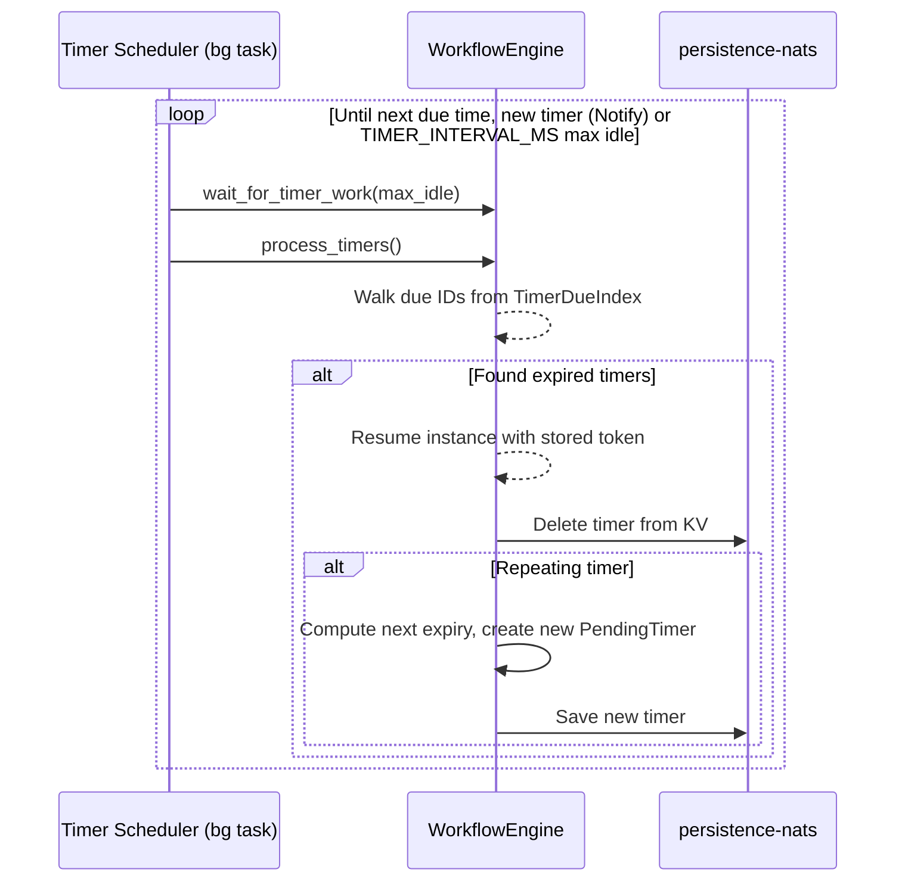
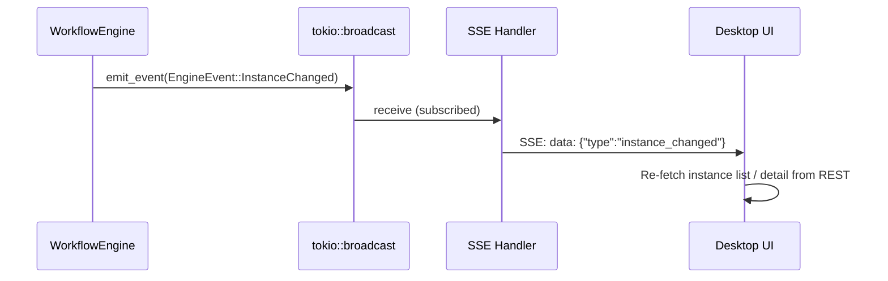
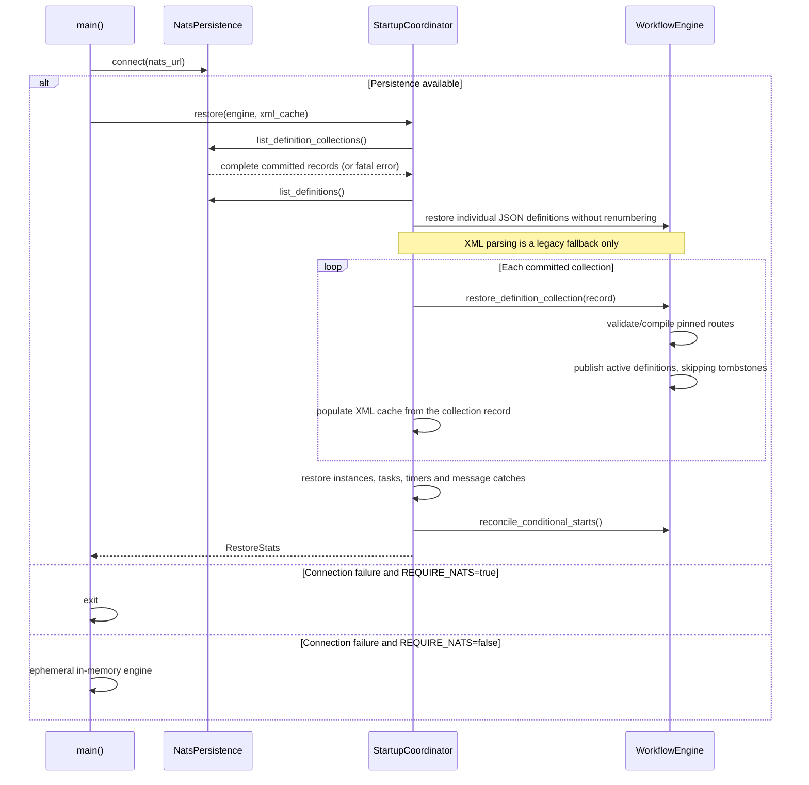
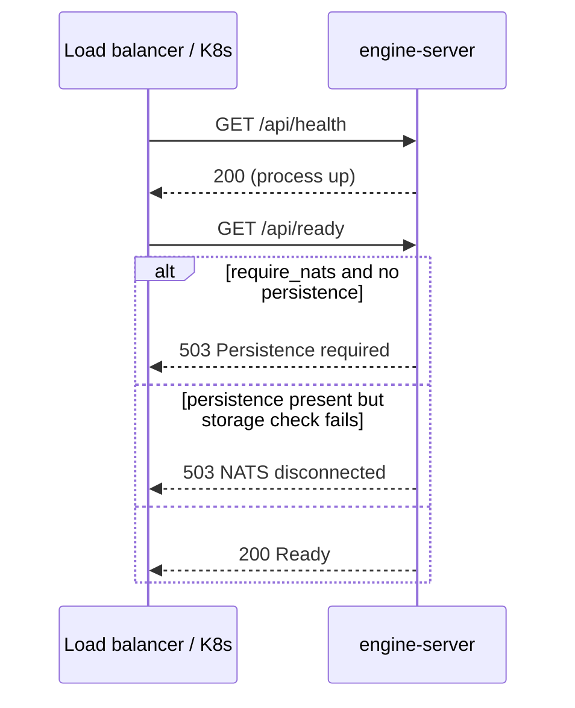
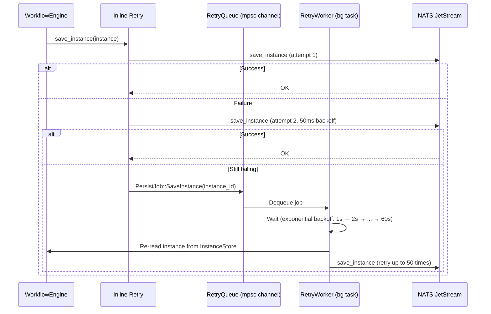

# Data Flows

## 1. Deployment and Routing Flows

### Single-process deployment

### Collection deployment

Validation and definitive commit failures publish no pools. Collection persistence
uses `definition_collections`, does not enqueue background retries, and must fit
the broker payload limit. A lost acknowledgment may require restart recovery
before retrying. Version allocation assumes one engine writer per store.

### Read-only receiver preflight

`plan_internal_messages` reads routes indexed by the source definition key,
then selects only the pinned target definition, element and business key.
Message starts yield a start plan; catches yield exact instance/catch/token IDs.
Missing, deleted or ambiguous receivers produce explicit unavailable results.
Other pools/versions, signals and stale/inactive occurrences are excluded.

The supplied payload is a snapshot per flow; planning changes no sender or
receiver state. Plans are not reservations. Public message-name correlation
remains separate; durable delivery and automatic internal sends are pending.
See [the X12 contract](../../x12-collaboration-plan.md).

## 2. Instance Execution Flow

## 3. Service Task (Fetch-and-Lock)

## 4. Timer Processing

## 5. SSE Event Push

## 6. Startup Restore Flow

Collection read/validation errors abort restoration. A collection is never
restored by reparsing only its first process. Keys and version gaps survive
restarts, including batches interleaved with individual deployments. Deleted
members remain tombstoned; pinned routes never fall back to newer versions.

## 7. Health vs Readiness

## 8. Persistence Retry (Fault-Tolerant)

