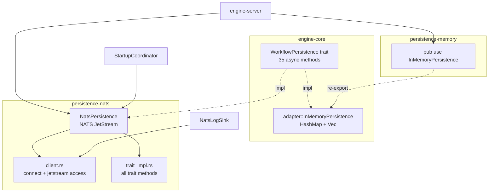

# persistence — Dependencies

## Outbound

| Dependency | Type | Used By | Purpose |
|-----------|------|---------|---------|
| engine-core | Rust crate | Both backends | `WorkflowPersistence` trait + all domain types |
| async-nats | External crate | persistence-nats | NATS JetStream client (KV, Object Store, Streams) |
| serde_json | External crate | persistence-nats | JSON serialization |
| futures | External crate | persistence-nats | Stream operations for KV key listing |
| tracing | External crate | persistence-nats | Logging (NATS connection status) |

## Inbound

| Caller | How | Backend | For |
|--------|-----|---------|-----|
| engine-server (main.rs) | Direct import | NATS (+ optional in-memory) | NATS required when `REQUIRE_NATS=true`; else soft-fallback |
| engine-core (WorkflowEngine) | Trait impl | Both | `Some(Arc<dyn WorkflowPersistence>)` |
| engine-core (retry_queue) | Trait impl | Both | Retry worker calls save/delete methods |
| engine-core (StartupCoordinator) | Direct import | NATS | `NatsPersistence::connect()` → restore state |
| engine-server (log_nats) | Direct import | NATS | `NatsLogSink::new(p.jetstream())` |

## Trait Implementation Diagram

## NATS Bucket / Store Map

| Bucket / Store | Type | Content | Key |
|----------------|-----|--------|-----|
| `definitions` | KV | `ProcessDefinition` (JSON) | `{definition_uuid}` |
| `instances` | KV | Active `ProcessInstance` (JSON) | `{instance_uuid}` |
| `user_tasks` | KV | `PendingUserTask` (JSON) | `{task_uuid}` |
| `service_tasks` | KV | `PendingServiceTask` (JSON) | `{task_uuid}` |
| `timers` | KV | `PendingTimer` (JSON) | `{timer_uuid}` |
| `messages` | KV | `PendingMessageCatch` (JSON) | `{catch_uuid}` |
| `tokens` | KV | `Token` (JSON) | `token-{instance_uuid}-{token_uuid}` |
| `history_instances` | KV | Archived (completed) `ProcessInstance` | `{instance_uuid}` |
| `bpmn_xml` | Object Store | BPMN XML source | `{definition_uuid}` |
| `instance_files` | Object Store | File variables (binary) | `file:{instance_id}-{var_name}-{filename}` |
| `WORKFLOW_HISTORY` | Stream | `HistoryEntry` (JSON), Subject `history.instance.{instance_uuid}` | — |
| `WORKFLOW_EVENTS` | Stream | Subjects `WORKFLOW_EVENTS.*` (created on connect) | — |
| `ENGINE_LOGS` | Stream | Log buffer backup (max 50,000 entries, `engine-server/log_nats.rs`) | — |

Source: `persistence-nats/src/client.rs` (creation) and `trait_impl.rs` (access). Keys carry **no** prefix except `tokens` and `instance_files`.
