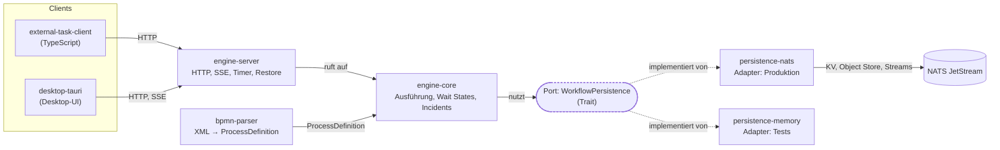
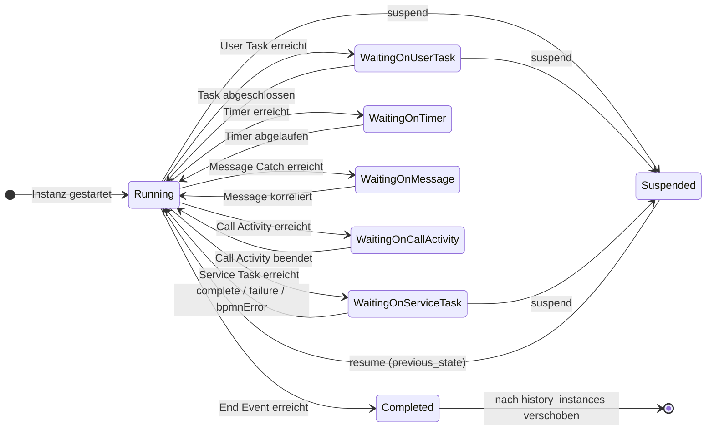
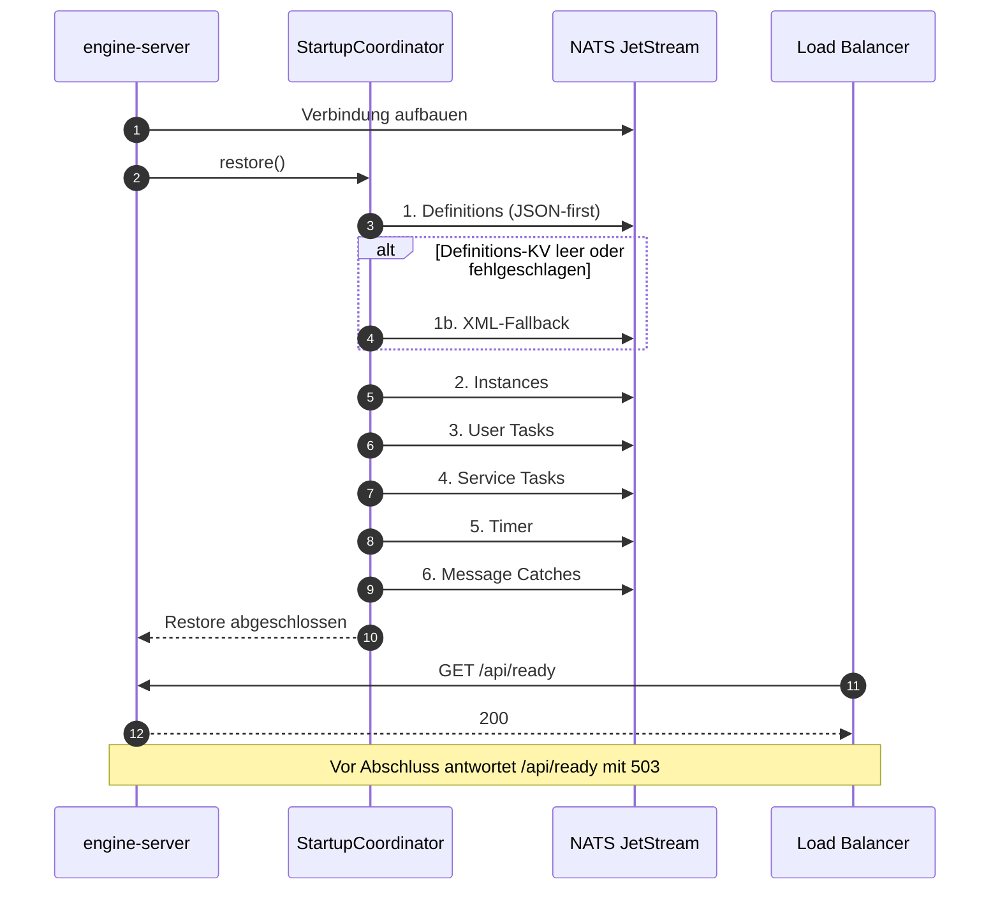

# Architektur verstehen

Diese Seite erklärt, **warum** BPMNinja so gebaut ist. Sie beschreibt keine Schritte und keine Parameterlisten — die stehen in `reference/` und `how-to/`. Sie beschreibt Entscheidungen, ihre Konsequenzen und die Stellen, an denen die Architektur bewusst Grenzen zieht.

Die Aussagen sind gegen die Architektur-ADRs (`docs/knowledge-base/architecture/decisions.md`, ADR-001 bis ADR-010), die Datenfluss-Dokumentation (`docs/knowledge-base/architecture/data-flows.md`) und die Modul-Gotchas belegt. Wo eine Aussage nicht belegt ist, steht sie unter **Offen**.

> **Wo du gerade einsteigst:** Diese Seite ist Schritt 1 des Lesepfads D („Ich will eine Eignungsentscheidung") und Schritt 3 des Lesepfads A. Wenn du die Begriffe noch nicht kennst, lies zuerst [`explanation/konzepte.md`](konzepte.md). Alle Pfade: [Dokumentationslandingpage](../README.md#lesepfade).

---

## 1. Die Grundform: Ports & Adapters

BPMNinja trennt Domänenlogik von Infrastruktur über einen expliziten Port (ADR-001). `engine-core` definiert das Trait `WorkflowPersistence`; die Implementierungen sind Adapter: `persistence-nats` für den Produktivbetrieb, `persistence-memory` für Tests und ephemere lokale Läufe.

**Komponenten und Port-Grenze.** Die entscheidende Kante ist die gestrichelte: `engine-core` kennt nur den Port `WorkflowPersistence`, nicht die Adapter dahinter. Es gibt keine Kante von `engine-core` zu NATS.

<!-- Alt-Text: Blockdiagramm. engine-server ruft engine-core auf; engine-core definiert den Port WorkflowPersistence; persistence-nats und persistence-memory implementieren diesen Port. engine-core hat keine Kante zu NATS. bpmn-parser liefert ProcessDefinition an engine-core. external-task-client und desktop-tauri sprechen über HTTP mit engine-server. -->

**Warum das wichtig ist:** Die Engine-Logik kennt kein NATS. Sie kennt nur „speichere diese Instanz", „lade diese Tokens", „lösche diesen Task". Das hat drei Konsequenzen:

1. **Testbarkeit ohne Infrastruktur.** Der In-Memory-Adapter erlaubt es, die gesamte Ausführungslogik ohne Broker zu testen.
2. **Austauschbarkeit der Persistenz.** Ein anderer Backend-Adapter wäre möglich, ohne `engine-core` anzufassen.
3. **Eine harte Invariante, die Beitragende kennen müssen:** `engine-core` importiert keine NATS-Typen. Diese Invariante ist in `docs/knowledge-base/modules/engine-core/dependencies.md` festgehalten („engine-core does NOT depend on: async-nats"). *Offen:* `docs/knowledge-base/modules/engine-core/responsibility.md` formuliert an einer Stelle, `async-nats`-Typen erschienen indirekt über das Trait — das widerspricht der Dependencies-Seite und ist als Audit-Befund AUD-016 erfasst. Für die Architekturbewertung gilt die Dependencies-Aussage.

**Konsequenz für den Betrieb:** Der Adapter ist eine Konfigurationsentscheidung, keine Codeentscheidung. Ob die Engine Zustand hält, hängt davon ab, welcher Adapter angehängt ist — und ob er erreichbar ist. Genau daraus folgt die Readiness-Semantik in Abschnitt 6.

---

## 2. Der Kern: Token-basierte Ausführung

BPMNinja führt Prozesse nicht als Baum von Aktivitäten aus, sondern als **Menge von Tokens** (ADR-002). Ein Token ist eine Ausführungsmarke, die genau eine Position im Prozessgraph repräsentiert. Ein linearer Prozess hat ein Token; ein paralleler Pfad hat mehrere.

### 2.1 Wo Tokens leben

Tokens liegen **zentral** in `ProcessInstance.tokens: HashMap<Uuid, Token>`. Pending-Objekte — `PendingUserTask`, `PendingServiceTask`, `PendingTimer`, `PendingMessageCatch` — halten **nur** eine `token_id: Uuid`, niemals eine Kopie des Tokens.

Das ist die wichtigste Invariante des Ausführungsmodells, und sie ist nicht kosmetisch:

- **Es gibt genau eine Wahrheit über die Position eines Tokens.** Wenn ein Worker einen Service Task abschließt, wird das Token aus dem zentralen Store gelesen, weitergeschoben und zurückgeschrieben. Es gibt keinen zweiten Ort, an dem eine veraltete Position stehen könnte.
- **Pending-Objekte sind Zeiger, keine Zustände.** Ein `PendingServiceTask` sagt „an diesem Knoten wartet Arbeit", nicht „das Token steht hier". Der Unterschied wird sichtbar, wenn ein Token manuell verschoben wird (`POST /api/instances/{id}/move-token`): Das Pending-Objekt bleibt, das Token bewegt sich.
- **Die Wiederaufnahme ist ein Lookup.** Wenn ein Task abgeschlossen wird, holt die Engine das Token über `token_id` aus `instance.tokens` und setzt die Ausführung dort fort. Es gibt keinen Rekonstruktionsschritt.

### 2.2 Der Ausführungszyklus

Die Ausführung läuft in `run_instance_batch` über `execute_step`, das einen `NextAction`-Wert zurückgibt. Der `NextAction`-Enum ist der eigentliche Motor: Er sagt, was als Nächstes passiert — weiterlaufen, auf einen User Task warten, auf einen Service Task warten, auf einen Timer warten, auf eine Message warten, abschließen, terminieren.

**Warum ein Enum und keine Callback-Kette:** Der Zyklus bleibt explizit und testbar. Jeder Schritt ist eine Funktion von (Instanzzustand, Knoten) auf (neuer Instanzzustand, nächste Aktion). Das macht das Verhalten bei Wait States deterministisch: Ein Wait State ist kein Sonderfall im Code, sondern ein `NextAction`-Wert, der die Schleife verlässt und den Zustand persistiert.

**Konsequenz:** Ein Prozess, der nie einen Wait State erreicht, läuft in einem Batch durch. Ein Prozess mit Wait States wird nach jedem Wait State persistiert. Die Batch-Grenze ist damit auch die Persistenz-Granularität — und der Grund, warum ein Absturz mitten in einem Batch Arbeit wiederholen kann (siehe Abschnitt 5).

**Zustände einer Instanz.** Jeder Wait State ist ein `NextAction`-Wert, der die Ausführungsschleife verlässt und den Zustand persistiert. `Completed` ist kein Endpunkt der Speicherung: Die Instanz wechselt in den Bucket `history_instances`.

<!-- Alt-Text: Zustandsdiagramm einer Process Instance. Aus Running führen Übergänge in fünf Wait States: WaitingOnUserTask, WaitingOnServiceTask, WaitingOnTimer, WaitingOnMessage, WaitingOnCallActivity. Aus jedem Wait State führt die passende Auflösung zurück nach Running. Running kann nach Completed wechseln; Completed wird nach history_instances verschoben. Aus Running und den Task-Wait-States kann Suspended erreicht werden, das den vorherigen Zustand merkt und dorthin zurückkehrt. -->

### 2.3 Parallele Pfade und Joins

Parallele Pfade entstehen als mehrere Tokens. An einem Join muss die Engine wissen, worauf sie wartet. BPMNinja nutzt dafür eine `JoinBarrier` mit `expected_count`.

- **AND-Join:** wartet auf alle eingehenden Flüsse.
- **XOR-Join:** synchronisiert nicht; das ankommende Token läuft weiter.
- **OR-Join (Inclusive):** wartet auf die **tatsächlich genommenen** Zweige. Der Parser legt dafür keine Join-Metadaten an; die Engine findet den Partner zur Laufzeit über `find_downstream_join` und setzt `expected_count` auf die Anzahl der am Split genommenen Zweige.

**Die bewusste Grenze:** Ein unstrukturierter OR-Join — also ein Join ohne passenden Split im selben Graph — fällt auf AND-artiges Verhalten zurück (`incoming_flow_count`). Das ist eine Approximation, keine BPMN-konforme Semantik. Wer unstrukturierte Inclusive-Gateways modelliert, bekommt ein anderes Warte-Verhalten als in Camunda. Die belegte Abweichung steht in [`explanation/konzepte.md`](konzepte.md) und in der kanonischen Abweichungsliste [`reference/kompatibilitaet.md`](../reference/kompatibilitaet.md).

---

## 3. Komponenten und ihre Verantwortlichkeiten

Die Aufteilung folgt der Ports-and-Adapters-Form. Jede Komponente hat eine klar benannte Verantwortung; die Moduldokumentation in `docs/knowledge-base/modules/` ist die Referenz für Beitragende.

| Komponente | Verantwortung | Was sie bewusst **nicht** tut |
|---|---|---|
| `bpmn-parser` | XML → `ProcessDefinition`: Element-Abbildung, Timer-Parsing, Listener-Extraktion, Sub-Process-Flattening | Keine Ausführung, kein Zustand, keine Validierung gegen Laufzeitbedingungen |
| `engine-core` | Domänentypen, Ausführungsschleife, Wait-State-Queues, Incident-Modell, Persistenz-Port | Keine I/O, kein HTTP, kein NATS |
| `persistence-nats` | `WorkflowPersistence` über NATS JetStream: KV, Object Store, Streams | Keine Retry-Politik — die liegt in `engine-core` |
| `persistence-memory` | In-Memory-Adapter für Tests und ephemere Läufe | Keine Dauerhaftigkeit über einen Neustart hinaus |
| `engine-server` | HTTP-API (Axum), SSE-Brücke, Timer-Scheduler, Startup-Restore, Log-Buffer, Durability-Gates | Keine Ausführungslogik — es ruft `engine-core` auf |
| `external-task-client` | TypeScript-Client für das Fetch-and-Lock-Pattern | Keine Idempotenz-Garantie — die muss der Worker-Code liefern |
| `desktop-tauri` | Desktop-UI: bpmn-js-Modeler, Instanz-Viewer, Monitoring, SSE-Listener | Keine eigene Zustandsführung — die Engine ist die Wahrheit |

**Die Grenze, die am häufigsten missverstanden wird:** `engine-server` ist eine dünne Schicht. Wenn ein Betriebsteam „die Engine" sagt, meint es meist `engine-server` — aber die Zustandsmaschine, die über Incident und Wait State entscheidet, liegt in `engine-core`. Ein Fehlerbild im HTTP-Log ist deshalb nicht automatisch ein Serverfehler.

---

## 4. Datenflüsse: der Weg durch das System

Die Datenfluss-Dokumentation beschreibt sieben Sequenzen. Für das Architekturverständnis sind vier davon zentral.

### 4.1 Deployment

Ein Deploy ist **zwei** Effekte, nicht einer: Das XML wird geparst und als `ProcessDefinition` gespeichert, und das Roh-XML wird separat im Object Store abgelegt. Die geparste Definition ist danach unveränderlich (`Arc<ProcessDefinition>`); ein erneuter Deploy derselben `bpmn_process_id` erzeugt eine neue Version, keine Änderung.

**Warum das zählt:** Laufende Instanzen bleiben auf ihrer Version. Eine Änderung am Modell wirkt sich nicht auf Instanzen aus, die bereits laufen — bis jemand explizit migriert. Das ist die Grundlage dafür, dass Migration und Modification zwei verschiedene Operationen sind (siehe [`explanation/konzepte.md`](konzepte.md)).

### 4.2 Instanz-Ausführung

Start → Instanz und Token anlegen → `run_instance_batch` → pro Schritt `execute_step` → bei Wait State Token zentral speichern und Pending-Objekt persistieren.

**Die Reihenfolge ist die Architektur:** Erst wird der Zustand im Speicher fortgeschrieben, dann persistiert. Ein Absturz zwischen diesen beiden Schritten hinterlässt einen Zustand, der beim Neustart aus der Persistenz rekonstruiert wird — nicht aus dem Speicher. Deshalb ist die Persistenz nicht optional, sondern die Definition von „die Instanz existiert".

### 4.3 Service Task: Fetch-and-Lock

Die Engine stellt Arbeit in eine Queue; ein Worker holt sie per `fetchAndLock`, erhält eine Sperre, arbeitet, und meldet `complete`, `failure` oder `bpmnError` zurück. Das ist das Camunda-Muster (ADR-005), mit eigenen Endpunktpfaden und eigenen Retry-/Incident-Semantiken.

**Die Konsequenz, die man nicht wegkonfigurieren kann:** Eine Sperre läuft ab. Wenn ein Worker länger braucht als `lockDuration`, kann ein zweiter Worker denselben Task holen. Die Engine garantiert damit **At-least-once**, nicht Exactly-once. Worker-Code muss idempotent sein — das ist keine Empfehlung, sondern eine Eigenschaft des Modells. Details: [`reference/service-task-api.md`](../reference/service-task-api.md).

### 4.4 Startup-Restore

Beim Start verbindet sich die Engine mit NATS und stellt den Zustand in einer festen Reihenfolge wieder her: Definitions (JSON-first, XML nur als Fallback), Instances, User Tasks, Service Tasks, Timer, Message Catches.

**Warum JSON-first:** Die geparste Definition ist die Wahrheit; das XML ist das Artefakt. Ein Restore, der XML neu parst, würde bei einer Parser-Änderung andere Definitionen erzeugen als beim Deploy. Der JSON-Pfad verhindert diese Drift. Fällt der Definitions-KV leer aus oder schlägt er fehl, greift der XML-Fallback — aber ein Persistenz-*Fehler* wird als Fehler propagiert, nicht als leere Liste behandelt.

**Die Betriebskonsequenz:** Der Restore läuft synchron im Startpfad. Bei sehr großem Zustand verzögert sich die Readiness. `/api/ready` liefert bis zur verifizierten NATS-Verbindung `503`. Das ist beabsichtigt: Ein Load Balancer soll keine Arbeit an eine Engine schicken, die ihren Zustand noch nicht kennt.

<!-- Alt-Text: Sequenzdiagramm des Startvorgangs. engine-server verbindet sich mit NATS. Dann ruft StartupCoordinator restore auf und stellt in fester Reihenfolge wieder her: Definitions JSON-first mit XML-Fallback, Instances, User Tasks, Service Tasks, Timer, Message Catches. Erst danach liefert /api/ready 200. Vorher liefert es 503. -->

---

## 5. Persistenz: was gespeichert wird und was das kostet

### 5.1 Die Speicherform

NATS JetStream trägt drei Rollen: KV-Buckets für Entitäten, Object Store für Dateien, Streams für Historie und Events. Die acht KV-Buckets sind nach Entitätstyp getrennt: `definitions`, `instances`, `user_tasks`, `service_tasks`, `timers`, `messages`, `tokens` und `history_instances`. Die zwei Object Stores heißen `bpmn_xml` (Original-XML) und `instance_files` (Datei-Anhänge). Vollständige Liste mit Inhalt: [`reference/konfiguration.md`](../reference/konfiguration.md#9-persistierte-strukturen-nats-jetstream). Beleg: `persistence-nats/src/client.rs` Zeilen 19–42 (`KV_BUCKETS`, `OBJECT_STORES`). Die Knowledge-Base-Seite `persistence/gotchas.md` nennt ältere Namen (`message_catches`, `history`, `history_completed_instances`); verbindlich ist der Adapter.

**Warum getrennte Buckets statt eines großen:** Jeder Entitätstyp hat einen eigenen Lebenszyklus und eigene Zugriffsmuster. Ein Token-Lookup beim Task-Abschluss darf nicht durch Instanz-Scans laufen. Die Trennung ist die Voraussetzung dafür, dass `load_tokens` per Key-Prefix-Scan nur die Tokens einer Instanz liest.

### 5.2 Der Lebenszyklus einer abgeschlossenen Instanz

Wenn eine Instanz `Completed` erreicht, wird sie in `history_instances` gespeichert und aus dem aktiven `instances`-Bucket entfernt. Sie ist **nicht gelöscht** — sie ist an einem anderen Ort.

**Die Konsequenz:** Wer nach Abschluss nach einer Instanz sucht, findet sie über den History-Pfad, nicht über den aktiven Pfad. Das ist der Grund, warum `GET /api/history/instances` existiert und warum eine abgeschlossene Instanz in `GET /api/instances` nicht mehr erscheint.

### 5.3 Fehlertoleranz: zwei Stufen, eine harte Grenze

Persistenzschreibvorgänge laufen zweistufig (ADR-007, ADR-010):

1. **Inline:** zwei Versuche mit 50 ms Abstand.
2. **Hintergrund:** eine begrenzte `mpsc`-Queue (Default-Kapazität 10 000, `PERSISTENCE_RETRY_QUEUE_CAPACITY`) mit exponentiellem Backoff bis 60 s und maximal 50 Versuchen.

**Die bewusste Grenze:** Ist die Queue voll, werden neue Jobs **verworfen** und als `bpmn_persistence_retry_dropped_total` gezählt. Das ist eine Entscheidung gegen unbegrenztes Wachstum und für einen definierten Speicherverbrauch. Bei einem längeren NATS-Ausfall bedeutet sie: Ein Teil der Schreibvorgänge geht verloren, und der Zähler ist der einzige Beleg dafür.

**Warum das vertretbar ist:** Der Retry-Worker liest den aktuellen Zustand neu, bevor er schreibt. Ein verworfener Job ist damit kein verlorener Zwischenschritt, sondern ein verlorener *Versuch*, den aktuellen Zustand zu schreiben. Der nächste erfolgreiche Schreibvorgang für dieselbe Entität bringt den Zustand auf den dann aktuellen Stand. Was verloren geht, ist die Garantie, dass *jeder* Zwischenstand persistiert wurde — nicht die Fähigkeit, den Endzustand zu erreichen. Wer diese Garantie braucht, muss den Zähler alarmieren und den Ausfall behandeln. Ein Runbook für den NATS-Ausfall (`how-to/betrieb/nats-ausfall.md`) ist **geplant (P0)** und existiert noch nicht; die belegten Gegenmaßnahmen stehen in [`how-to/konfiguration-anpassen.md`](../how-to/konfiguration-anpassen.md) Schritt 6 und 7.

### 5.4 Retention: die Falle, die vor dem ersten Start entschieden wird

Die Streams `WORKFLOW_EVENTS` und `WORKFLOW_HISTORY` werden mit expliziten Grenzen angelegt und bei jedem Start **abgeglichen**: `max_age`, `max_bytes`, `num_replicas`. Defaults sind 7 Tage für Events, 30 Tage für History, 1 GiB pro Stream, 1 Replica.

**Die Architekturkonsequenz:** Der Abgleich ändert nur diese drei Werte, nicht Subjects, Storage-Typ oder Discard-Policy. Aber er ändert sie *bei jedem Start*. Wer die Retention-Variablen nach dem ersten Start setzt, ändert die Grenzen rückwirkend — und kann dabei Daten verlieren, die unter der alten Grenze noch galten. Deshalb müssen die Retention-Variablen **vor** dem ersten Start gesetzt sein. Das ist keine Betriebsempfehlung, sondern eine Eigenschaft des Bootstrap-Verhaltens.

---

## 6. Skalierung: wo sie funktioniert und wo nicht

### 6.1 Was skaliert

**Nebenläufigkeit innerhalb eines Prozesses.** Die vier Wait-State-Queues sind `Arc<DashMap>` (ADR-004). Das bedeutet: gleichzeitige Task-Operationen blockieren sich nicht gegenseitig über einen globalen Lock. Instanzzustand ist pro Instanz über ein `RwLock` geschützt. Der Server teilt die Engine nur über `Arc<WorkflowEngine>`; alle Mutationen laufen über `&self`.

**Warum das wichtig ist:** Unter hoher HTTP-Last — viele Worker, die gleichzeitig `fetchAndLock` und `complete` aufrufen — entsteht kein einzelner Engpass. Die Kosten sind auf die betroffenen Shards verteilt.

**Die Invariante, die daraus folgt:** Ein `DashMap`-Ref oder ein `RwLock`-Guard darf **nie** über ein `.await` gehalten werden. Wer das verletzt, blockiert einen Shard für die Dauer des I/O. Diese Regel steht in `docs/knowledge-base/modules/engine-core/responsibility.md` und ist für Beitragende bindend.

**Worker-Seite.** External Tasks skalieren horizontal: Mehr Worker mit demselben Topic holen mehr Tasks. Die Engine muss dafür nicht skaliert werden — sie ist die Queue.

### 6.2 Was nicht skaliert

**Die Engine ist ein Single Writer.** Es gibt keinen Mechanismus, mit dem zwei `engine-server`-Instanzen denselben NATS-Zustand gleichzeitig führen. Zwei Instanzen würden dieselben KV-Keys überschreiben und dieselben Tokens unabhängig fortschreiben.

**Die Konsequenz für den Betrieb:** Skalierung erfolgt über die Worker-Seite, nicht über die Engine-Seite. Wer mehr Durchsatz braucht, erhöht die Zahl der Worker oder die `maxTasks` pro `fetchAndLock`. Wer die Engine horizontal skalieren will, braucht eine Partitionierung des Zustands — die es nicht gibt.

*Offen:* Die Aussage „Single Writer" ist aus der Architektur abgeleitet, aber nicht durch eine explizite ADR belegt. Sie ist als Audit-Befund geführt.

### 6.3 Was begrenzt ist

| Grenze | Wert | Beleg |
|---|---|---|
| Incidents pro Instanz | 100 (`MAX_INCIDENTS_PER_INSTANCE`) | `docs/knowledge-base/modules/engine-core/gotchas.md` |
| Persistenz-Retry-Queue | 10 000 Jobs, dann Drop mit Zähler | `docs/knowledge-base/modules/engine-core/gotchas.md` |
| SSE-Broadcast-Kanal | 256 Ereignisse, kein Catch-up | `docs/knowledge-base/modules/engine-server/gotchas.md` |
| Log-Buffer | 5 000 Einträge im Speicher, 50 000 im NATS-Stream | `bpmninja/README.md` |
| Rhai-Skripte | 50 000 Operationen, 2 MiB, 1 000 ms | `docs/knowledge-base/modules/engine-core/gotchas.md` |

---

## 7. Die drei Betriebsrisiken in einer Tabelle

Diese Tabelle ist die Zusammenfassung für eine Eignungsentscheidung. Jede Zeile nennt das Risiko, seine Ursache und die belegte Gegenmaßnahme.

| Risiko | Ursache | Gegenmaßnahme | Beleg |
|---|---|---|---|
| **Fail-closed Auth** | Ohne Key und mit Nicht-Loopback-Bind antworten alle `/api`-Routen mit `401` | Admin- und Worker-Key setzen; `BIND_ADDR` bewusst wählen | [`how-to/konfiguration-anpassen.md`](../how-to/konfiguration-anpassen.md) Schritt 2–3 |
| **Begrenzte Retry-Queue mit Drop** | Bei vollem Puffer werden Persistenz-Jobs verworfen | `bpmn_persistence_retry_dropped_total` alarmieren; NATS-Ausfall behandeln | Abschnitt 5.3 dieser Seite |
| **Retention-Abgleich beim Start** | Der erste Start mit niedrigeren Limits verwirft ältere Nachrichten sofort | Retention-Variablen **vor** dem ersten Start setzen | [`how-to/konfiguration-anpassen.md`](../how-to/konfiguration-anpassen.md) Schritt 7 |

---

## Nächster sinnvoller Schritt

Wenn du die Begriffe hinter diesen Entscheidungen brauchst, lies:

→ **[`explanation/konzepte.md`](konzepte.md)** — Token, Wait State, Service Task vs. External Task, Incident, Migration, Modification, Flattening, Rhai — je mit Trade-off und Abweichung.

Wenn du die Konfiguration für deinen Betrieb umsetzen willst, lies:

→ **[`how-to/konfiguration-anpassen.md`](../how-to/konfiguration-anpassen.md)** — Bind-Adresse, Keys, Durability, Limits, Retention mit Prüfschritt nach jedem Block.

Wenn du die Verträge nachschlagen willst, die aus dieser Architektur folgen, lies:

→ **[`reference/rest-api.md`](../reference/rest-api.md)** — Routengruppen, Rollenmatrix, Statuscodes.

---

## Offen

- **`async-nats`-Abhängigkeit von `engine-core`:** `dependencies.md` sagt „nein", `responsibility.md` formuliert indirekt „ja" (Audit AUD-016). Diese Seite folgt der Dependencies-Aussage. **Offen:** Klärung durch das technische Review.
- **`persistence-memory` als direkte Abhängigkeit von `engine-server`:** Widersprüchlich (Audit AUD-017).
- **`WorkflowPersistence`-Trait-Liste:** Unvollständig (Audit AUD-021).
- **KV-Bucket-Namen:** Der Widerspruch aus Audit AUD-022 (`bpm_*` vs. Kurznamen) ist aufgelöst. Kanonisch sind die acht Namen in [`reference/konfiguration.md`](../reference/konfiguration.md#9-persistierte-strukturen-nats-jetstream), geprüft gegen `persistence-nats/src/client.rs`. Ein `bpm_*`-Präfix existiert in Version 0.7.24 nicht.
- **„Single Writer":** Aus der Architektur abgeleitet, nicht durch eine ADR belegt.
- **Geplante Seiten:** `how-to/betrieb/nats-ausfall.md` und `explanation/grenzen-und-trade-offs.md` sind im Dateiplan als P0/P1 geführt, existieren aber nicht. Sie sind hier **nicht verlinkt**, sondern als „geplant" im Text genannt. `reference/konfiguration.md` und `reference/kompatibilitaet.md` sind inzwischen geschrieben.
- **Ankerlinks:** Die internen Verweise auf `#lesepfade` und `#schritt-…` zeigen auf Überschriften mit Umlauten und Sonderzeichen. Die Linkprüfung prüft Anker nicht. **Offen:** Ankerauflösung im Zielsystem einmalig prüfen.
