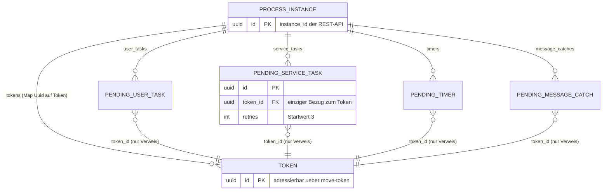
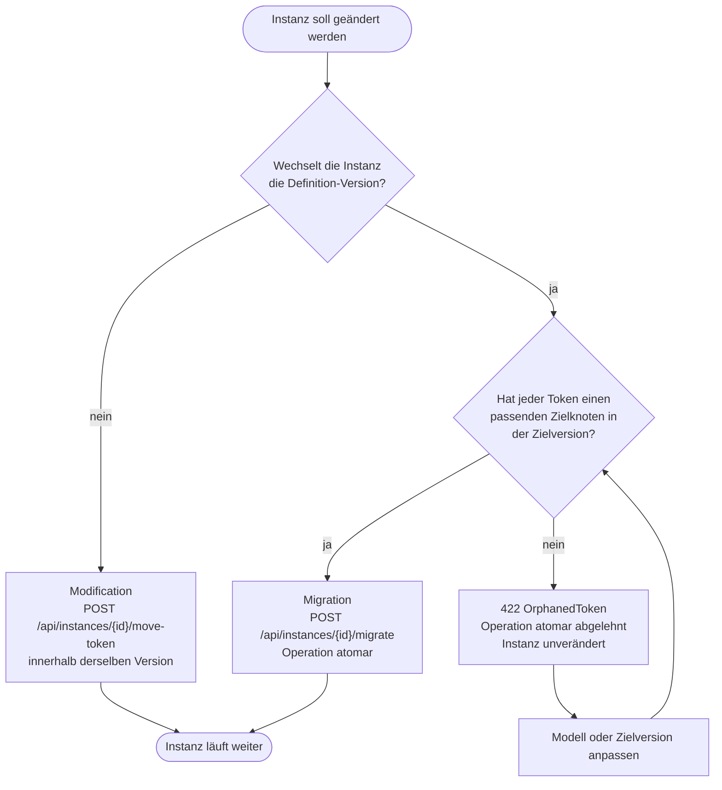

# Zentrale Konzepte und Trade-offs

Diese Seite erklärt die Begriffe, an denen sich entscheidet, ob jemand BPMNinja richtig benutzt. Sie ist keine Referenz — die Verträge stehen in `reference/`. Sie ist auch kein Glossar — die verbindliche Abgrenzung ähnlicher Begriffe steht in [`_review/glossary.md`](../_review/glossary.md). Sie erklärt, **warum** ein Konzept so geschnitten ist und **was es kostet**.

Die Struktur ist bewusst gleich: Jedes Konzept nennt die Idee, den Trade-off und die Abweichung, die daraus für vergleichbare Systeme folgt.

**Lesepfad:** Wenn du neu bist, lies die Abschnitte 1, 2 und 3. Wenn du von Camunda kommst, lies zusätzlich 4 bis 8 — dort stehen die Abweichungen, die deine Modelle betreffen. Wenn du eine Eignungsentscheidung treffen willst, lies die [Zusammenfassungstabelle](#zusammenfassung-die-acht-abweichungen-in-einer-tabelle) am Ende.

---

## 1. Token: die Ausführungsmarke

**Die Idee.** Ein Prozess wird nicht als Baum von Aktivitäten ausgeführt, sondern als Menge von Tokens. Ein Token ist eine Marke an genau einer Position im Graph. Parallele Pfade sind mehrere Tokens; ein Join ist das Warten auf mehrere Tokens an einem Knoten.

**Der Trade-off.** Tokens sind explizit und zentral gespeichert. Das macht den Zustand inspizierbar und die Wiederaufnahme trivial — aber es macht jeden Schritt zu einer Zustandsänderung, die persistiert werden muss. Ein token-basiertes Modell ist teurer pro Schritt als ein Interpreter, der den Graph abarbeitet, ohne den Zwischenzustand zu materialisieren.

**Die Abweichung.** Camunda 7 verwendet intern ebenfalls ein Token-Modell, dokumentiert es aber nicht als Nutzerkonzept. BPMNinja macht es sichtbar: `ProcessInstance.tokens` ist Teil des Instanzzustands, und `POST /api/instances/{id}/move-token` ist eine öffentliche Operation. Wer von Camunda kommt, muss wissen, dass ein Token hier ein adressierbares Objekt ist.

**Was daraus folgt.** Ein Token kann verschoben werden, ohne dass ein Pending-Objekt verschwindet. Ein Pending-Task ist ein Zeiger auf ein Token, kein Token. Wer das verwechselt, sucht den Fehler an der falschen Stelle.

**Warum das ein Datenmodell und keine Metapher ist.** Das Diagramm zeigt die zwei Objektfamilien und die einzige Kante zwischen ihnen: Die Instanz hält die Tokens, jedes Pending-Objekt hält nur eine `token_id`. Es gibt keine Kante, die eine Kopie des Tokens in ein Pending-Objekt trägt.

<!-- Alt-Text: Entity-Relationship-Diagramm des Instanzzustands. Eine Process Instance hält mehrere Tokens. Dieselbe Instanz hält mehrere Pending-Objekte: PendingUserTask, PendingServiceTask, PendingTimer und PendingMessageCatch. Jedes Pending-Objekt verweist über das Feld token_id auf genau ein Token. Die Position im Graph steht nur im Token, nicht im Pending-Objekt. -->

**Lesehinweis:** Von links nach rechts gelesen ist die Instanz der Container, das Token der Zustand, das Pending-Objekt die Wartemarke. Verschoben wird immer nur das Token — die Wartemarke bleibt an ihrem Knoten stehen. Deshalb ändert ein `move-token` den `current_node` der Instanz, aber nicht die Menge der offenen Pending-Objekte.

**Beleg:** `explanation/architektur.md` §2.1 (`ProcessInstance.tokens: HashMap<Uuid, Token>`; Pending-Objekte halten nur `token_id: Uuid`); `docs/knowledge-base/modules/engine-core/interfaces.md`; `retries: 3` aus dem Live-Lauf vom 2026-10-24 (`_qa/verification-report.md` §2.3).

---

## 2. Wait State: der Punkt, an dem die Engine anhält

**Die Idee.** Die Engine läuft, bis sie auf etwas warten muss: einen User Task, einen Service Task, einen Timer, eine Message, eine Call Activity. An diesem Punkt persistiert sie den Zustand und gibt die Kontrolle ab.

**Der Trade-off.** Ein Wait State ist die Grenze zwischen „im Batch ausgeführt" und „persistiert". Je mehr Wait States, desto mehr Persistenzschreibvorgänge; je weniger, desto länger die Batches und desto mehr Arbeit, die bei einem Absturz wiederholt wird.

**Die Abweichung.** Flowable formuliert das generisch („die Engine läuft bis zum Wait State, persistiert, wartet"). BPMNinja hat fünf Wait-State-Arten, jede mit eigener Queue und eigenem Pending-Typ. Das ist expliziter als bei manchen Engines, die Wait States intern uniform behandeln.

**Was daraus folgt.** Ein Prozess ohne Wait State ist ein einzelner Batch. Ein Prozess mit vielen Wait States hat viele Persistenzpunkte — und damit viele Stellen, an denen ein Persistenzfehler sichtbar wird. Die Retry-Queue ist die Antwort darauf, nicht die Vermeidung.

---

## 3. Service Task und External Task: Element und Arbeitseinheit

**Die Idee.** Ein Service Task ist ein BPMN-Element. Ein External Task ist die Arbeitseinheit, die daraus entsteht, wenn die Engine die Ausführung an einen externen Worker delegiert. Die Engine stellt Arbeit in eine Queue; ein Worker holt sie per Fetch-and-Lock, arbeitet, und meldet das Ergebnis zurück.

**Der Trade-off.** Das Muster entkoppelt die Engine von der Arbeitstechnologie: Der Worker kann in jeder Sprache geschrieben sein, auf jeder Maschine laufen, unabhängig deployt werden. Der Preis ist eine Sperre, die ablaufen kann — und damit At-least-once statt Exactly-once.

**Die Abweichung.** Camunda 7 hat dasselbe Muster (ADR-005). BPMNinja übernimmt es mit eigenen Endpunktpfaden (`/api/service-task/...` statt `/external-task/...`) und eigenen Retry-/Incident-Semantiken. Ein Camunda-Client lässt sich deshalb nicht unverändert weiterverwenden; der TypeScript-Client von BPMNinja ist die passende Schnittstelle.

**Was daraus folgt.** Der Worker-Code muss **idempotent** sein. Das ist keine Empfehlung, sondern eine Eigenschaft des Modells: Wenn die Sperre abläuft, bevor `complete` ankommt, holt ein zweiter Worker denselben Task. Ein zweiter Lauf darf keinen doppelten Effekt haben. Die Lock-Dauer wird in **Millisekunden** gesendet; die kanonische Definition steht in [`reference/service-task-api.md`](../reference/service-task-api.md).

**Der praktische Einstieg.** Wie du einen solchen Worker baust und alle drei Ergebniswege (`complete`, `failure`, `bpmnError`) belegst: [`how-to/external-task-worker-schreiben.md`](../how-to/external-task-worker-schreiben.md).

---

## 4. Incident: der persistierte Fehlerzustand

**Die Idee.** Ein Incident ist ein Fehlerzustand **an einer Process Instance**, der manuelles Eingreifen erfordert. Er ist kein Log-Eintrag und keine Exception: Er wird persistiert, ist über die API abfragbar und bleibt offen, bis jemand ihn behandelt.

**Die vier Arten.** `service_task` (ein External Task hat `retries <= 0` erreicht, **oder** ein `bpmnError` hat kein passendes Boundary Error Event gefunden), `timer` (ein Timer konnte nicht verarbeitet werden), `persistence` (ein Schreibvorgang ist nach allen Wiederholungen gescheitert), `bpmn_error` (Enum-Wert ist vorhanden; der auslösende Fall ist nicht belegt — der ungefangene `bpmnError` erzeugt nach Live-Lauf vom 2026-10-24 die Art `service_task`, siehe `_qa/verification-report.md` §2.3).

**Der Trade-off.** Ein persistierter Incident überlebt einen Neustart und ist damit nachvollziehbar. Der Preis ist, dass Incidents **aufgeräumt** werden müssen: Pro Instanz sind maximal 100 gespeichert; beim Trimmen weichen aufgelöste vor offenen Incidents, jeweils die ältesten. Ein unbehandelter Incident-Bestand verdrängt also irgendwann ältere Einträge.

**Die Abweichung.** In Camunda ist ein Incident ebenfalls ein persistiertes Objekt, aber mit eigener Oberfläche und eigener Auflösungslogik. BPMNinja bietet zwei Wege: `retry` (Retries zurücksetzen, der Task wird wieder fetchbar) und `resolve` (Task ohne Worker manuell abschließen). Beide sind **Admin-only** — ein Worker-Key erhält `403`. `resolve` auf dem Service-Task-Pfad schließt den Task, löst den Incident aber nicht automatisch auf; dafür dient `POST /api/instances/{id}/incidents/{incident_id}/resolve`.

**Was daraus folgt.** Ein Incident ist ein Betriebszustand, kein Programmierfehler. Wer ihn sieht, muss entscheiden: War der Fehler vorübergehend (`retry`) oder ist die Arbeit erledigt bzw. nicht mehr nötig (`resolve`)? Die Endpunkte stehen in [`reference/rest-api.md`](../reference/rest-api.md#instances).

---

## 5. Migration: laufende Instanzen auf eine andere Version heben

**Die Idee.** Eine Process Definition ist unveränderlich. Ein erneuter Deploy derselben `bpmn_process_id` erzeugt eine neue `version`, keine Änderung an der alten. Laufende Instanzen bleiben deshalb auf ihrer Version — bis jemand sie explizit migriert.

**Der Trade-off.** Unveränderliche Definitionen machen laufende Instanzen reproduzierbar: Ein Prozess, der gestern gestartet wurde, läuft heute noch nach dem Modell von gestern. Der Preis ist, dass eine Korrektur am Modell nicht automatisch für laufende Instanzen gilt.

**Die Abweichung.** Die Migration verschiebt Zustand und Tokens auf die Zielversion. Ein Token, das im Zielmodell keinen passenden Knoten findet, erzeugt `OrphanedToken` und wird mit **422** abgelehnt — die Migration ist damit atomar: entweder alle Tokens finden ein Ziel, oder keine wird verschoben.

**Was daraus folgt.** Vor einer Migration prüfst du, ob alle Knoten, an denen aktuell Tokens stehen, in der Zielversion noch existieren. Ein umbenannter Knoten ist ein fehlender Knoten.

---

## 6. Modification: eine laufende Instanz ändern, ohne die Version zu wechseln

**Die Idee.** Die Modification ändert **innerhalb** einer Instanz: Variablen setzen, ein Token auf einen anderen Knoten verschieben. Die Definition bleibt dieselbe.

**Der Trade-off.** Die Modification ist das Werkzeug für den Notfall — ein Modellfehler, der nur eine Instanz betrifft, lässt sich reparieren, ohne eine neue Version zu deployen. Der Preis ist, dass der Instanzzustand danach nicht mehr dem entspricht, was das Modell bei einem normalen Lauf erzeugt hätte.

**Die Abweichung.** Migration und Modification werden häufig verwechselt. Der Unterschied ist einfach: **Migration wechselt die Version, Modification nicht.** Ein Token-Verschub ist eine Modification (`POST /api/instances/{id}/move-token`), ein Versionswechsel ist eine Migration (`POST /api/instances/{id}/migrate`).

**Was daraus folgt.** Nach einer Modification ist die Instanz ein Sonderfall. Wenn du sie später migrierst, prüfe zuerst, ob der manuell gesetzte Zustand in der Zielversion noch sinnvoll ist.

**Die Entscheidung in einem Bild.** Die Unterscheidung hängt an einer Frage: Wechselt die Instanz die Version ihrer Definition? Wenn ja, ist es eine Migration — und ein Token ohne Zielknoten in der Zielversion macht die Operation unmöglich.

<!-- Alt-Text: Entscheidungsflussdiagramm. Frage 1: Wechselt die Instanz die Definition-Version? Nein führt zu Modification über move-token innerhalb derselben Version. Ja führt zu Frage 2: Hat jeder Token einen Zielknoten in der Zielversion? Nein führt zu 422 OrphanedToken, die Operation ist atomar und ändert nichts. Ja führt zu Migration über migrate, die Operation ist atomar. -->

---

## 7. Flattening: Sub-Prozesse werden aufgelöst

**Die Idee.** Embedded Sub-Prozesse werden zur **Parse-Zeit** in den Hauptgraph eingebettet (ADR-003). Zur Laufzeit gibt es keine verschachtelten Instanzstrukturen, nur direkte Knotensequenzen. Rücksprünge aus dem Sub-Prozess werden über generierte Knoten simuliert.

**Der Trade-off.** Ein flacher Graph macht die Token-Verwaltung einfach: Es gibt keine Scope-Hierarchie, in der ein Token „im Sub-Prozess" oder „im Elternprozess" sein kann. Jedes Token ist an genau einem Knoten. Der Preis ist, dass Sub-Prozess-Scoping zur Laufzeit — etwa ein Boundary Event, das nur den Sub-Prozess abbricht — nicht in derselben Form möglich ist wie in Camunda.

**Die Abweichung.** Wer echtes Runtime-Scoping braucht, verwendet eine **Call Activity**: Sie erzeugt eine eigene Kind-Instanz mit eigenem Zustand. Das ist die dokumentierte Alternative, nicht ein Workaround.

**Was daraus folgt.** Ein Modell, das in Camunda mit Embedded Sub-Prozessen und Boundary Events arbeitet, verhält sich nach dem Deploy anders. Prüfe vor der Migration, ob du Scoping brauchst — dann ist die Call Activity die richtige Wahl.

---

## 8. Rhai: Skripte laufen nicht in JavaScript

**Die Idee.** Script Tasks und Execution Listener werden in **Rhai** ausgeführt, sandboxed mit Operations-, Speicher- und Zeitlimits (ADR-008): 50 000 Operationen, 2 MiB Speicher, 1 000 ms Laufzeit.

**Der Trade-off.** Rhai ist in Rust eingebettet, ohne externe Runtime. Es gibt keinen Node-Prozess, keinen JVM-Start, keine Brücke zwischen Sprachen. Die Sandbox ist Teil der Engine, nicht ein separates Sicherheitsmodell. Der Preis ist, dass bestehende Camunda-Modelle mit JavaScript- oder Groovy-Skripten übersetzt werden müssen.

**Die Abweichung.** Rhai hat keine Gesamt-Heap-Grenze; das Speicherbudget leitet deshalb String-, Array- und Map-Grenzen ab. Ein Skript, das mehr als 50 000 Operationen oder 1 000 ms braucht, bricht ab — und das ist ein Fehlerfall, kein Retry.

**Was daraus folgt.** Wenn deine Logik mehr braucht als eine Sandbox zulässt, gehört sie nicht in ein Skript, sondern in einen **External Task**. Die Engine bleibt dann der Koordinator, und die Arbeit läuft in deinem Worker mit deinen Grenzen.

---

## Zusammenfassung: die acht Abweichungen in einer Tabelle

| Konzept | Was BPMNinja anders macht | Was du dadurch tun musst |
|---|---|---|
| Token | Tokens sind adressierbar und über die API verschiebbar | Pending-Task und Token nicht verwechseln |
| Wait State | Fünf Arten, je mit eigener Queue | Persistenzfehler an der richtigen Queue suchen |
| External Task | Eigene Endpunktpfade, At-least-once | Worker-Code idempotent bauen |
| Incident | Persistiert, maximal 100 pro Instanz, `retry`/`resolve` Admin-only | Incidents als Betriebszustand behandeln, nicht als Bug |
| Migration | Atomar: `OrphanedToken` → 422 | Vor der Migration prüfen, ob alle Knoten in der Zielversion existieren |
| Modification | Ändert die Instanz, nicht die Version | Nach der Änderung den Zustand als Sonderfall behandeln |
| Flattening | Kein Runtime-Scoping für Embedded Sub-Prozesse | Call Activity verwenden, wenn Scoping gebraucht wird |
| Rhai | Sandbox mit 50 000 Operationen, 2 MiB, 1 000 ms | Schwere Logik in einen External Task verlagern |

---

## Nächster sinnvoller Schritt

Wenn du wissen willst, wie diese Konzepte im System umgesetzt sind, lies:

→ **[`explanation/architektur.md`](architektur.md)** — Komponenten, Datenflüsse, Persistenz und die drei Betriebsrisiken.

Wenn du einen Worker bauen willst, der die Fehlerpfade aus Abschnitt 3 und 4 belegt, lies:

→ **[`how-to/external-task-worker-schreiben.md`](../how-to/external-task-worker-schreiben.md)** — `fetchAndLock`, `complete`, `failure`, `bpmnError` mit Prüfliste.

Wenn du einen Begriff nachschlagen willst, lies:

→ **[`_review/glossary.md`](../_review/glossary.md)** — verbindliche Definition, Synonyme und Abgrenzung je Begriff.

---

## Offen

- **Incident-Art `bpmn_error`:** Der Enum-Wert existiert (`engine-server/interfaces.md` §Incident-API), aber der auslösende Fall ist nicht belegt. Sicher belegt ist nur: Ein ungefangener `bpmnError` aus einem Service Task erzeugt `service_task`. **Offen:** Zuordnung der Art `bpmn_error` (vermutlich Error End Event) mit einem Live-Lauf klären.
- **Anzahl der Incident-Arten:** Diese Seite nennt vier. Ob weitere Varianten existieren, ist aus der Knowledge Base nicht abschließend belegt.
- **Vollständige Abweichungsliste:** Diese Seite nennt die belegten Abweichungen im Kontext. Die kanonische, vollständige Tabelle steht in [`reference/kompatibilitaet.md`](../reference/kompatibilitaet.md).
- **Element-Abbildung:** Die Referenz XML → `BpmnElement` mit Attributauflösung und Ablehnungsfällen steht in [`reference/bpmn-elemente.md`](../reference/bpmn-elemente.md).
- **Camunda-Vergleich:** Die Aussagen zu Camunda 7 und Flowable stützen sich auf `_research/domain-research.md` und die ADRs, nicht auf einen Live-Vergleich.
- **Datenmodell-Diagramm (Abschnitt 1):** Die Mermaid-Syntax ist geprüft (`verify_mermaid`, 2026-10-24); ein Rendering im Zielrenderer ist für dieses Diagramm noch nicht belegt.
- **Ankerlinks:** Der Verweis auf `#instances` und `#zusammenfassung-die-acht-abweichungen-in-einer-tabelle` zeigt auf Überschriften mit Umlauten und Sonderzeichen. Die Linkprüfung prüft Anker nicht. **Offen:** Ankerauflösung im Zielsystem einmalig prüfen.
