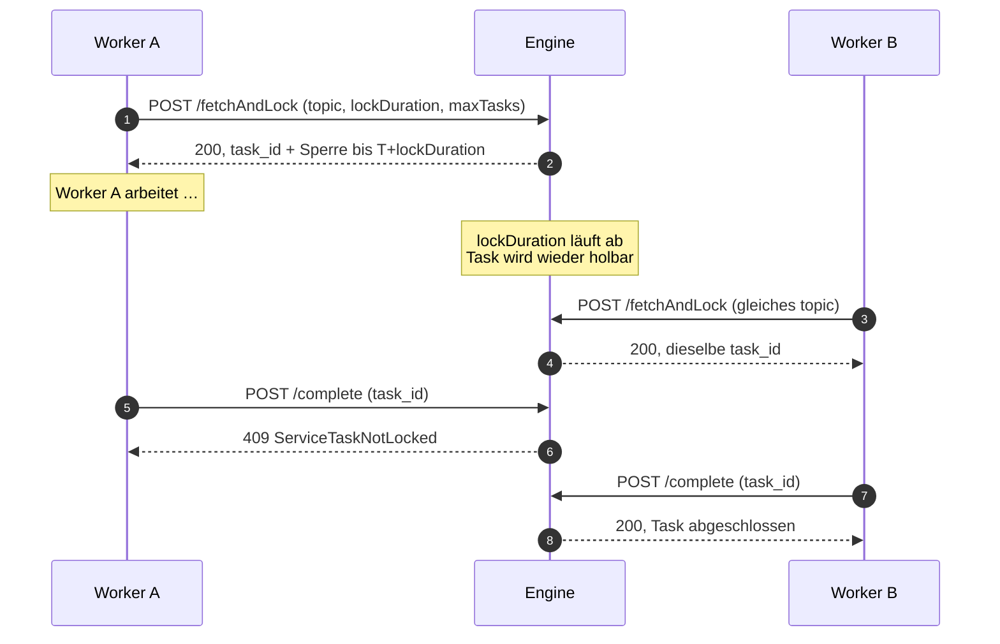

# Service-Task-API

Diese Seite ist die **kanonische Definition der Lock-Dauer** (Entscheidung E7 der Informationsarchitektur). Andere Seiten verweisen hierher und wiederholen die Einheit nicht.

Service Tasks pausieren die Ausführung und legen die Aufgabe in eine Fetch-and-Lock-Queue. Externe Worker holen Aufgaben per Topic, bearbeiten sie und melden das Ergebnis über die API zurück. Das Muster entspricht den Camunda-7-External-Tasks.

**Beleg:** `docs/knowledge-base/modules/engine-server/interfaces.md` §„HTTP lock duration", §„Rollenmatrix"; `external-task-client/gotchas.md`; `cross-cutting/shared-patterns.md` §„Camunda-Compatible Service Task API"; Live-Lauf vom 2026-10-24 (`_qa/verification-report.md` §2.3).

---

## 1. Endpunktübersicht

| Methode | Pfad | Admin | Worker | Zweck |
|---|---|---|---|---|
| `GET` | `/api/service-tasks` | erlaubt | **403** | Alle Service Tasks auflisten |
| `POST` | `/api/service-task/fetchAndLock` | erlaubt | erlaubt | Tasks per Long-Polling holen und sperren |
| `POST` | `/api/service-task/{id}/complete` | erlaubt | erlaubt | Erfolgreich abschließen |
| `POST` | `/api/service-task/{id}/failure` | erlaubt | erlaubt | Fehler melden (Retry oder Incident) |
| `POST` | `/api/service-task/{id}/extendLock` | erlaubt | erlaubt | Sperre verlängern |
| `POST` | `/api/service-task/{id}/bpmnError` | erlaubt | erlaubt | Fachlichen Fehler melden (Boundary Error Event) |
| `POST` | `/api/service-task/{id}/retry` | erlaubt | **403** | Retries zurücksetzen (Incident-Behandlung) |
| `POST` | `/api/service-task/{id}/resolve` | erlaubt | **403** | Task ohne Worker manuell abschließen |

---

## 2. Lock-Dauer — kanonische Definition

**Einheit am HTTP-Rand: Millisekunden.**

| Feld | Endpunkt | Einheit | Erlaubter Bereich | Verhalten außerhalb |
|---|---|---|---|---|
| `topics[].lockDuration` | `POST /api/service-task/fetchAndLock` | **ms** | `1_000` bis `3_600_000` | `400`, kein Long-Poll |
| `newDuration` | `POST /api/service-task/{id}/extendLock` | **ms** | **wird nicht validiert** | keine Ablehnung; `engine-core` klemmt die umgerechneten Sekunden auf `1..=3600` |

**Interne Umrechnung:** Der Server rechnet Millisekunden in Sekunden um, aufgerundet:

```text
seconds = (ms + 999) / 1000
```

`engine-core` klemmt die Sekunden defensiv auf `1..=3600` (`TimeDelta::try_seconds`) — auch bei `extend_lock`. Werte außerhalb führen daher nie zu einem Panic **und nie zu einem `400`**: `extendLock` hat keinen Validierungspfad. Beleg: Live-Lauf vom 2026-10-24 (`newDuration: 30` → `204`; `_qa/verification-report.md` §2.3); `engine-server/src/server/state.rs` (`lock_duration_ms_to_secs`), `engine-server/src/server/tasks.rs` (`extend_lock`). Die Grenzen `1_000..=3_600_000` gelten ausschließlich für `fetchAndLock`.

**Jedes Topic behält seine eigene Lock-Dauer.** Intern: `WorkflowEngine::fetch_and_lock_service_tasks_with_durations(worker_id, max_tasks, &[(topic, secs)])`. Die alte Signatur `fetch_and_lock_service_tasks(..., lock_duration)` bleibt als Wrapper erhalten.

**Beispiel — 30 Sekunden Sperre:**

```bash
curl -s -X POST http://localhost:8081/api/service-task/fetchAndLock \
  -H "Content-Type: application/json" \
  -H "X-API-Key: $BPMNINJA_WORKER_API_KEY" \
  -d '{"workerId":"worker-01","maxTasks":1,"topics":[{"topicName":"send-email","lockDuration":30000}]}'
```

**Beispiel — Sekunden statt Millisekunden (erwartet 400):**

```bash
curl -s -o /dev/null -w "%{http_code}\n" -X POST http://localhost:8081/api/service-task/fetchAndLock \
  -H "Content-Type: application/json" \
  -d '{"workerId":"worker-01","maxTasks":1,"topics":[{"topicName":"send-email","lockDuration":30}]}'
# 400
```

**Beispiel — Sperre verlängern:**

```bash
curl -s -X POST http://localhost:8081/api/service-task/st-0001/extendLock \
  -H "Content-Type: application/json" \
  -H "X-API-Key: $BPMNINJA_WORKER_API_KEY" \
  -d '{"newDuration":60000}'
```

---

## 3. `fetchAndLock` — Validierung

Der Endpunkt validiert den Body **vor** dem Long-Poll. Schlägt eine Prüfung fehl, antwortet er sofort mit `400` und beginnt **kein** Warten.

| Feld | Regel |
|---|---|
| `topics` | 1 bis 32 Einträge |
| `topics[].topicName` | nicht leer (getrimmt) |
| `topics[].lockDuration` | `1_000..=3_600_000` ms |
| `maxTasks` | `1..=100` |

**Statuscodes:** `200` (Liste, ggf. leer), `400` (Validierung), `401` (fehlender oder falscher Key bei aktivem Gate). `403` kann auf dieser Route nicht auftreten, weil sie für die Worker-Rolle zugelassen ist.

**Antwort:** Ein Array von Tasks. Ein frisch angelegter Task hat `retries: 3`; `worker_id` und `lock_expiration` sind nach dem Holen gesetzt, `error_message` und `error_details` sind `null`:

```json
[
  {
    "id": "c2251b91-a72b-40a9-86ac-a22579e16b9c",
    "instance_id": "616a5c9f-b555-455d-aad6-b18ed9e4a997",
    "definition_key": "39613d30-4179-4069-9b8c-ae9b79771d0b",
    "node_id": "send-email",
    "topic": "send-email",
    "token_id": "12a9a5e4-0d99-4d15-96e7-c1b5bd0dfb3c",
    "business_key": "4d115a08-94df-4192-90c3-cc95465cd51a",
    "variables_snapshot": {"email": "kunde@example.com"},
    "created_at": "2026-10-24T11:36:38.075463Z",
    "worker_id": "howto-worker-02",
    "lock_expiration": "2026-10-24T11:37:10.826004Z",
    "retries": 3,
    "error_message": null,
    "error_details": null
  }
]
```

**Long-Polling:** Der Aufruf wartet, bis Aufgaben verfügbar sind oder das Timeout greift. Der TypeScript-Client steuert das über `asyncResponseTimeout`.

---

## 4. Ergebnis-Endpunkte

### `complete`

Schließt den Task erfolgreich ab und setzt optional Ausgabevariablen.

```bash
curl -s -X POST http://localhost:8081/api/service-task/st-0001/complete \
  -H "Content-Type: application/json" \
  -H "X-API-Key: $BPMNINJA_WORKER_API_KEY" \
  -d '{"variables":{"emailSent":true}}'
```

| Status | Auslöser |
|---|---|
| `204` | Task abgeschlossen (leerer Body) |
| `401` | Fehlender oder falscher Key bei aktivem Gate |
| `404` | `ServiceTaskNotFound` |
| `409` | `ServiceTaskLocked` (anderer Worker hält die Sperre) oder `ServiceTaskNotLocked` (Complete auf ungesperrtem Task) |

### `failure`

Meldet einen Fehler. Die Engine dekrementiert die Retries; bei `retries: 0` entsteht ein Incident.

```bash
curl -s -X POST http://localhost:8081/api/service-task/st-0001/failure \
  -H "Content-Type: application/json" \
  -H "X-API-Key: $BPMNINJA_WORKER_API_KEY" \
  -d '{"errorMessage":"SMTP timeout","errorDetails":"connect ETIMEDOUT","retries":0}'
```

| Status | Auslöser |
|---|---|
| `204` | Fehler registriert (leerer Body) |
| `401` | Fehlender oder falscher Key bei aktivem Gate |
| `404` | `ServiceTaskNotFound` |
| `409` | Lock-Konflikt |

### `bpmnError`

Meldet einen **fachlichen** Fehler. Die Engine routet auf ein passendes `BoundaryErrorEvent` mit dem angegebenen `errorCode`.

```bash
curl -s -X POST http://localhost:8081/api/service-task/st-0001/bpmnError \
  -H "Content-Type: application/json" \
  -H "X-API-Key: $BPMNINJA_WORKER_API_KEY" \
  -d '{"errorCode":"INVALID_ADDRESS"}'
```

| Status | Auslöser |
|---|---|
| `204` | Fehler registriert und geroutet (leerer Body) |
| `401` | Fehlender oder falscher Key bei aktivem Gate |
| `404` | `ServiceTaskNotFound` |
| `409` | Task nicht von diesem Worker gesperrt (`ServiceTaskNotLocked`), von einem anderen Worker gesperrt (`ServiceTaskLocked`) oder nicht mehr `pending` (`TaskNotPending`) |

Findet der `errorCode` kein passendes Boundary Error Event, entsteht ein Incident der Art **`service_task`** mit der Meldung `Unhandled BPMN error '<CODE>'` (Live-Lauf vom 2026-10-24, `_qa/verification-report.md` §2.3). `docs/openapi.yaml` nennt für diesen Fall `400`; die Engine liefert `204` und legt den Incident an — diese Seite folgt der Engine. Der Aufruf wird **nie** wiederholt. Die Instanz bleibt `WaitingOnServiceTask`; der Task lässt sich per `retry` oder `resolve` weiterbehandeln.

### `extendLock`

Verlängert die Sperre. `newDuration` ist in **Millisekunden** anzugeben.

```bash
curl -s -X POST http://localhost:8081/api/service-task/st-0001/extendLock \
  -H "Content-Type: application/json" \
  -H "X-API-Key: $BPMNINJA_WORKER_API_KEY" \
  -d '{"newDuration":60000}'
```

| Status | Auslöser |
|---|---|
| `204` | Sperre verlängert (leerer Body) |
| `401` | Fehlender oder falscher Key bei aktivem Gate |
| `404` | `ServiceTaskNotFound` |
| `409` | Task nicht von diesem Worker gesperrt |

`extendLock` prüft die Dauer nicht: Der Handler rechnet `newDuration` mit Aufrunden in Sekunden um (`0` oder negativ ergibt `0`). Die Grenzen `1_000..=3_600_000` gelten ausschließlich für `fetchAndLock`. Beleg: `engine-server/src/server/state.rs` (`lock_duration_ms_to_secs`), `engine-server/src/server/tasks.rs` (`extend_lock`), Live-Lauf vom 2026-10-24.

### `retry` und `resolve` — Admin-only

Beide Endpunkte behandeln einen Incident. Ein Worker-Key erhält **403**.

| Endpunkt | Wirkung | Status |
|---|---|---|
| `POST /api/service-task/{id}/retry` | Setzt die Engine-Retries zurück; der Task wird wieder fetchbar | `204`, `401`, `403`, `404` |
| `POST /api/service-task/{id}/resolve` | Schließt den Task ohne Worker manuell ab | `204`, `401`, `403`, `404` |

`resolve` schließt den Task, löst den zugehörigen Incident aber **nicht** automatisch auf — dafür dient `POST /api/instances/{id}/incidents/{incident_id}/resolve` (Live-Lauf vom 2026-10-24, `_qa/verification-report.md` §2.3).

```bash
curl -s -X POST http://localhost:8081/api/service-task/st-0001/retry \
  -H "X-API-Key: $BPMNINJA_API_KEY"
```

---

## 5. Lock-Ablauf und Idempotenz

Eine Sperre läuft nach `lockDuration` ab. Läuft sie ab, bevor `complete` ankommt, kann ein zweiter Worker denselben Task holen. Die Engine garantiert damit **At-least-once**, nicht Exactly-once.

**Warum die Sperre eine Frist ist, keine Garantie:** Der zweite `fetchAndLock` ist kein Fehler, sondern das definierte Verhalten. Der erste `complete` scheitert dann mit `409`.

<!-- Alt-Text: Sequenzdiagramm mit zwei Workern und der Engine. Worker A ruft fetchAndLock auf und erhält task_id mit Sperre. Worker A arbeitet. Die Sperre läuft ab. Worker B ruft fetchAndLock auf und erhält dieselbe task_id. Worker A sendet complete und erhält 409, weil die Sperre nicht mehr ihm gehört. Worker B sendet complete und schließt den Task ab. -->



**Konsequenz für den Worker-Code:** Jeder Handler muss idempotent sein. Ein zweiter Lauf desselben External Task darf keinen doppelten Effekt haben. Das ist keine Empfehlung, sondern eine Eigenschaft des Modells. Erklärung: [`explanation/konzepte.md`](../explanation/konzepte.md#3-service-task-und-external-task-element-und-arbeitseinheit).

**Gegenmaßnahmen im Client:**

| Maßnahme | Wirkung | Grenze |
|---|---|---|
| `lockDuration` groß genug wählen | Weniger ablaufende Sperren | Verzögert die Wiederaufnahme nach einem Worker-Absturz |
| `autoExtendLock: true` | Client verlängert bei 80 % von `lockDuration` | Ersetzt keine Idempotenz |
| Idempotenter Handler | Zweiter Lauf ohne doppelten Effekt | Muss im Code stehen, nicht in der Konfiguration |

---

## Offen

- **`errorRef`-Semantik (belegt):** Der Parser löst `errorRef` über eine Lookup-Tabelle aus allen `<bpmn:error>`-Elementen auf (`id` → `errorCode` → `name` → `id`). Trifft der Verweis kein Element, erhält das `BoundaryErrorEvent` `error_code = None` und fängt **jeden** `bpmnError`-Code an dieser Aktivität. Ein direkter String im `errorRef` ohne passendes `<bpmn:error>` ist damit kein exakter Match, sondern ein Catch-all. Beleg: `bpmn-parser/src/parser.rs` (`error_lookup`), `engine-core/src/engine/executor/helpers.rs` (`find_boundary_error_event`). Details: [`reference/bpmn-elemente.md`](bpmn-elemente.md#64-fehler-errorref).
- **Default-`retries`:** Ein frisch angelegter Service Task startet mit `retries: 3`; nach `retry` steht der Zähler wieder auf `3` (Live-Lauf vom 2026-10-24). Der Wert ist belegt, aber nicht als Konfigurationsvariable einstellbar.
- **Statuscode `409` auf `bpmnError`:** Die Tabelle nennt `409`; der Live-Lauf belegt für `bpmnError` nur `204`. `ServiceTaskNotLocked` und `TaskNotPending` sind in `engine-server/interfaces.md` als `409` dokumentiert, eine Live-Probe auf `bpmnError` mit ungesperrtem Task fehlt. **Offen:** bestätigen oder die Zeile entfernen.
- **`reference/fehlercodes.md`:** Im Dateiplan geführt, aber nicht geschrieben. Die vollständige `EngineError`-Zuordnung fehlt; die Statuscodes oben sind gegen `engine-server/interfaces.md` und den Live-Lauf belegt, aber nicht automatisiert gegen `docs/openapi.yaml` geprüft.
- **Konfiguration:** [`reference/konfiguration.md`](konfiguration.md).
- **Versionsstand:** Kein „gültig ab" auf dieser Seite. Die Zuordnung zu `0.7.24` (Rust/Desktop) und `1.0.0` (npm-Client) steht aus.
- **Ankerlinks:** Der Verweis auf `#3-service-task-und-external-task-element-und-arbeitseinheit` zeigt auf eine Überschrift mit Bindestrichen und Umlauten. Die Linkprüfung prüft Anker nicht. **Offen:** Ankerauflösung im Zielsystem einmalig prüfen.
